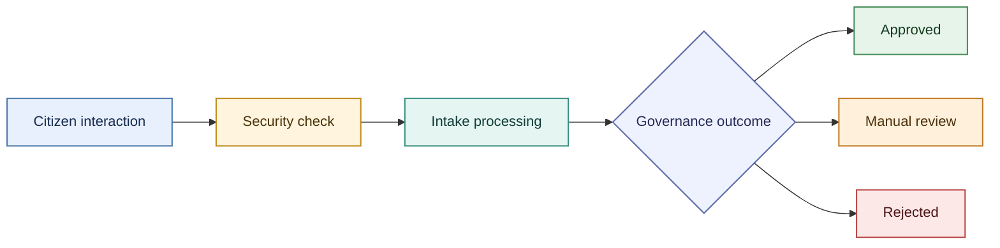

# Mermaid Diagram Standards

Use these standards whenever creating, editing, or reviewing Mermaid diagrams in Markdown documentation.

## Semantic Color Palette

Use a restrained, consistent palette so color reinforces meaning rather than decoration:

| Meaning | Fill | Border | Text |
| :--- | :--- | :--- | :--- |
| Ingress, contracts, or neutral information | `#e8f0fe` | `#4c78a8` | `#172b4d` |
| Security checks and safeguards | `#fff4dd` | `#c28a1a` | `#49330b` |
| Intake, processing, or delivery | `#e5f5f2` | `#3b8f83` | `#123c37` |
| Governance decisions and validation | `#eef2ff` | `#5968a8` | `#252b55` |
| Successful or approved outcomes | `#e6f4ea` | `#4a8f5b` | `#173b20` |
| Manual review or escalation | `#fff0db` | `#c27a24` | `#4d310d` |
| Rejection, blocking, or failure | `#fde8e8` | `#b94a48` | `#4a1515` |
| Persistence and audit records | `#f1eafe` | `#7955a1` | `#33214e` |

Assign colors by semantic role, not by node order. Keep the same role the same color across related diagrams. A node may use the nearest applicable role; do not add colors without a meaning.

## Mermaid Application

For flowcharts, define reusable classes and assign every meaningful node to one. Combine nodes into a class where appropriate:

For sequence diagrams, use Mermaid `theme: "base"` initialization with theme variables matching the palette for participants, signals, labels, notes, and activation bars. Avoid relying on renderer-specific defaults when color conveys meaning.

## Readability and Accessibility

- Use dark text on light fills and retain visible borders; do not use color as the only way to distinguish outcomes.
- Keep labels concise and describe domain concepts or architectural roles.
- Avoid emoji-only cues, excessive colors, gradients, and low-contrast text.
- Preserve readable text at normal document zoom; simplify or split a diagram if it becomes too dense.

## Validation Requirement

After creating or changing diagrams:

1. Render every changed Mermaid block with the project-supported renderer or Mermaid CLI.
2. Fix syntax errors rather than treating a successful Markdown edit as validation.
3. Inspect the rendered images for clipping, overlap, unreadable text, confusing branch layout, and intended color application.
4. Re-render and re-inspect after any visual or structural correction.

Do not report a diagram as visually validated unless it has been rendered and inspected.
