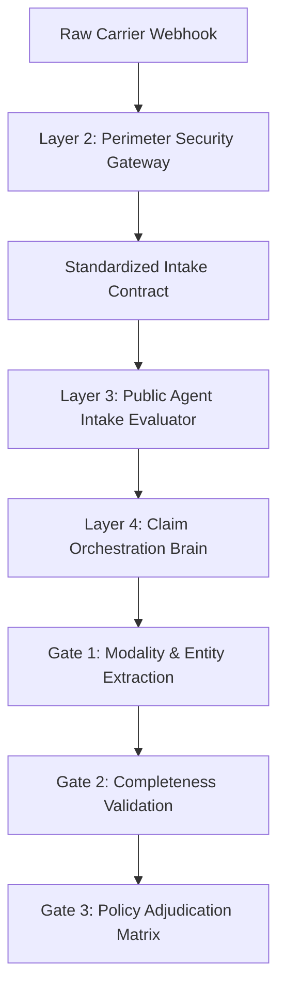

# Architectural Documentation Standards & Markdown Guidelines

This skill defines the principles, formatting rules, and style standards for writing and maintaining Markdown (`.md`) documentation, Architecture Decision Records (ADRs), system specifications, and workflow diagrams across the repository.

---

## 1. Core Philosophy: Conceptual & Domain-Driven Documentation

Markdown documents exist to convey **system architecture, domain invariants, business workflows, protocol boundaries, and governance rules**.

Implementation details change rapidly during refactoring. Documentation that is tightly coupled to concrete class names, method signatures, and file paths quickly becomes stale, misleading, and brittle.

> [!IMPORTANT]
> **The Golden Rule of Architectural Documentation:**
> Markdown files must describe **WHAT** the system does and **WHY** architectural decisions were made using conceptual domain terms. Code files (`.py`) define **HOW** it is implemented.

---

## 2. Strict Prohibition of Code-Level Symbols

Markdown (`.md`) files must NEVER include concrete code-level symbols, programming language artifacts, or source file locations.

### 2.1 No Class Names
* **Forbidden**: Using concrete Python class names (e.g., `PublicAgentStandardizedIntakePayload`, `ClaimOrchestrator`, `MultichannelNotificationService`, `IngestionFirewall`, `ZeroTrustIdentityTokenizer`).
* **Required**: Use descriptive architectural role names, conceptual contracts, or subsystem titles.

| Code-Level Identifier (Prohibited in `.md`) | Architectural / Conceptual Term (Required) |
| :--- | :--- |
| `PublicAgentStandardizedIntakePayload` | *Standardized Intake Payload* / *Canonical Intake Contract* |
| `WhatsAppIngressPayload` / `IvrIngressPayload` | *WhatsApp Ingress Contract* / *IVR Voice Ingress Contract* |
| `ClaimOrchestrator` | *Claim Orchestration Engine* / *Layer 4 Orchestrator* |
| `ClaimAdjudicator` | *Claim Adjudication Engine* / *Policy Decision Matrix* |
| `CaseManagementService` | *Case Management Service* / *Caseworker Lifecycle Manager* |
| `IngestionFirewall` | *Perimeter Security Gateway* / *Ingestion Firewall* |
| `ZeroTrustIdentityTokenizer` | *Zero-Trust Identity Tokenizer* / *Identity Tokenization Service* |
| `AdversarialPromptFirewall` | *Adversarial Prompt Firewall* / *Security Threat Scanner* |
| `PiiPurgeGuard` | *PII Purge Sentinel* / *Zero-PII Guard* |
| `MultichannelNotificationService` | *Adaptive Multi-Channel Notification Engine* |
| `GovernanceOutcomePayload` | *Governance Adjudication Outcome* / *Adjudication Result* |
| `NotificationRequestPayload` | *Outbound Notification Request* |
| `OutboundNotificationPayload` | *Channel Notification Payload* |
| `TransmissionAck` | *Carrier Transmission Acknowledgment Receipt* |

---

### 2.2 No File Paths or Source Code Filenames
* **Forbidden**: Referencing or hyperlinking specific source code files (e.g., `../src/data_models/public_agent/standardized_intake_payload.py`, `claim_orchestrator.py`, `public_agent_api.py`, `channel_settings.py`).
* **Required**: Reference the conceptual layer, subsystem, or architectural package boundary (e.g., *Layer 2 Perimeter Security Gateway*, *Layer 3 Public Agent Gateway*, *Layer 4 Orchestration Brain*, *Outbound Notification Service*).

---

### 2.3 No Internal Method Names or Function Signatures
* **Forbidden**: Documenting method names or invocation signatures (e.g., `ClaimOrchestrator.process_ingress_payload()`, `check_claim_completeness()`, `evaluate_claim()`, `BhashiniService.transcribe_audio()`, `submit_payload()`).
* **Required**: Describe the architectural stage, operational phase, or transformation gate:
  * Instead of `process_ingress_payload` $\rightarrow$ *Gate 1: Ingress Modality & SLM Entity Extraction*
  * Instead of `check_claim_completeness` $\rightarrow$ *Gate 2: Intake Completeness & Intent Validation Gate*
  * Instead of `evaluate_claim` $\rightarrow$ *Gate 3: Deterministic Policy Adjudication Matrix*
  * Instead of `transcribe_audio()` $\rightarrow$ *Speech-to-Text Audio Transcription via Bhashini ASR*
  * Instead of `tokenize_id()` $\rightarrow$ *One-Way SHA-256 HMAC Pseudonymization*

---

### 2.4 No Arbitrary Numeric Step Numbers in Workflow Descriptions
* **Forbidden**: Citing ephemeral or arbitrary workflow step numbers (e.g., *"Emitted by Step 11"*, *"Step 12 Multi-channel Delivery"*, *"Step 09 Claim Adjudicator"*). As workflows evolve, steps are split, merged, or re-ordered, causing numeric step citations to immediately become out of sync.
* **Required**: Reference workflow stages and processes exclusively by their **conceptual domain / architectural names**:
  * Instead of *"Step 11 (`caseworker_incident_staging`)"* $\rightarrow$ *Caseworker Incident Staging* / *Manual Escalation Queue*
  * Instead of *"Step 12 Multi-channel Confirmation"* $\rightarrow$ *Adaptive Multi-Channel Notification Engine*
  * Instead of *"Step 09 Adjudicator"* $\rightarrow$ *Deterministic Policy Adjudication Engine*
  * Instead of *"Step 10 Automated Payout"* $\rightarrow$ *Automated Payment Clearance Rails*

---

## 3. Diagrams & Visual Specifications (Mermaid)

All sequence diagrams, flowcharts, and architecture maps in `.md` files must follow the same strict separation:

### 3.1 Flowcharts
* **Node Labels**: Use conceptual steps, gates, contracts, and business rules.
* **Prohibited**: `PublicAgentApi.submit_payload`, `ClaimOrchestrator.check_claim_completeness`.
* **Correct**: `Layer 3 Structural Intake Evaluation`, `Gate 2: Completeness Validation`.

### 3.2 Sequence Diagrams
* **Participants**: Name participants by their architectural role (e.g., `Citizen / Carrier`, `Perimeter Security Gateway (Layer 2)`, `Public Agent Gateway (Layer 3)`, `Claim Orchestrator (Layer 4)`, `Sovereign DPI Services`).
* **Messages**: Describe the conceptual message or data exchange rather than method names:
  * **Correct**: `Submit Raw Webhook Payload`, `Transmit Normalized Zero-PII Contract`, `Execute Tri-State Adjudication`
  * **Incorrect**: `process_raw_ingress()`, `process_ingress()`, `evaluate_claim()`

---

## 4. Document Structure & Taxonomy

Markdown documents in this repository fall into four primary categories:

1. **Architecture Decision Records (ADRs) (`decisions/`)**:
   - Capture the rationale, alternatives evaluated, trade-offs, and invariants of key architectural decisions.
   - Structured as: Context $\rightarrow$ Decision $\rightarrow$ Architecture Invariants $\rightarrow$ Consequences.

2. **System Design Specifications (`design-specs/`)**:
   - Specify requirements, security boundaries, threat models, and DPI integration workflows.

3. **System Documentation & Code Flows (`docs/`)**:
   - Provide end-to-end data lifecycle overviews, sequence flows, and state transition matrices.

4. **Roadmap & Project Plans (`roadmap.md`, `README.md`)**:
   - High-level project status, architectural milestones, and module boundaries.

---

## 5. Authoring & Review Checklist

Before finalizing any `.md` file, verify:

- [ ] **No `.py` file paths**: Checked for `src/`, `.py`, or relative links to source code files.
- [ ] **No class names**: Replaced `*Payload`, `*Service`, `*Connector`, `*Gateway`, `*Validator` code symbols with domain concepts.
- [ ] **No method names**: Replaced `def `, `()`, or `ClassName.method_name` with functional stage descriptions.
- [ ] **Model-agnostic terminology**: No hardcoded commercial AI vendor or model names (uses *SLM Entity Extractor*, *ASR Worker*, *NMT Translation Service*).
- [ ] **Conceptual Mermaid diagrams**: All diagram nodes and sequence arrows use business and architectural roles.
- [ ] **Zero-Trust Security alignment**: Correctly articulates zero-PII guarantees, in-memory HMAC tokenization, and fail-fast invariants.
