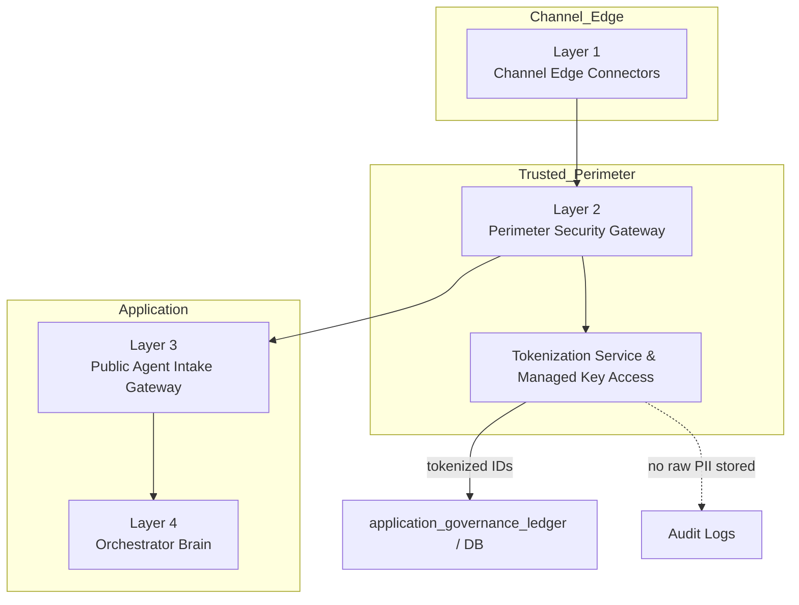

# Zero-Trust Purge & Tokenization Protocols

**Framework Step:** Phase 0 · Step 0.3: Establish Zero-Trust Purge & Tokenization Protocols
**Related Documents:**
- [roadmap.md](../roadmap.md)
- [step0.2_data_model_design.md](./step0.2_data_model_design.md)
- [step0.3_hashing_algorithm_evaluation.md](./step0.3_hashing_algorithm_evaluation.md)
- [step0.3_token_service_readme.md](./step0.3_token_service_readme.md)

---

## 1. Goal

Establish the strict zero-trust data privacy boundaries required for citizen PII. Specifically, identify the ingress points of cleartext PII (such as Aadhaar numbers or ANI phone numbers), define the in-memory tokenization protocol, and set non-negotiable architectural mandates to ensure cleartext PII never touches persistent disk storage.

---

## 2. PII Ingress Identification

Based on our multi-channel architecture, cleartext Personally Identifiable Information (PII) enters through Layer 1 and is tokenized at the Layer 2 perimeter before the pseudonymous intake contract is passed to Layer 3.

> **Note:** Layer 1 and Layer 2 must never write cleartext PII to persistent storage or disk logs. Layer 1 forwards it only in volatile memory to Layer 2; Layer 2 tokenizes it before forwarding the intake contract to Layer 3.

1. **Source Phone Number (ANI):** Reaches the system through channel connectors (WhatsApp webhook, IVR SIP gateway, USSD signaling). Layer 2 tokenizes it in volatile memory for session tracking; the cleartext value is not forwarded to Layer 3 or persisted.
2. **Citizen Identity Numbers (Aadhaar / Farmer ID):** May be provided in conversational text or structured input for identity verification. Raw Aadhaar must not be directly HMAC'd; use an authorized UIDAI-issued pseudonymous identifier where the applicable verification flow requires it.
3. **Location / Cadastral Data:** Geographic coordinates, property parcel identifiers, or farm boundary data may appear less sensitive in isolation, but once linked to a specific identity token they can be used to infer a person’s exact residence, land ownership, and movements. In that combined form, the data is treated as protected because it materially increases re-identification risk and privacy impact.
> [!WARNING] **Cleartext Ban**
> Under no circumstances will cleartext Aadhaar numbers or other highly sensitive citizen ID numbers be written to the database or written to disk-based application logs.

---

## 3. In-Memory Tokenization Protocol

To interact with downstream systems and maintain transactional consistency without violating privacy mandates, we will apply a one-way hashing protocol in volatile RAM.

### 3.1. Hashing Algorithm
Identifiers approved for pseudonymization are tokenized at the Layer 2 perimeter using **HMAC-SHA256**; see [step0.3_hashing_algorithm_evaluation.md](./step0.3_hashing_algorithm_evaluation.md) for the algorithm rationale.
- **Function:** `HMAC-SHA256`
- **Key Strategy:** Use a high-entropy cryptographic pepper held in an approved secrets manager and supplied at runtime. HMAC does not use a per-record salt.
- **Mathematical Specification:** `tokenized_citizen_id = HMAC-SHA-256(pepper, normalized_approved_identifier)`, resulting in an exact 64-character hexadecimal pseudonymous string.

- **Implementation (Concept):**
  ```python
  import hashlib
  import hmac

  token = hmac.new(
      pepper.encode(),
      normalized_approved_identifier.encode(),
      hashlib.sha256,
  ).hexdigest()
  ```

### 3.2 Execution Boundary & Rationale
Phone-number tokenization occurs at the trusted Layer 2 perimeter in volatile memory, before the standardized intake contract is passed to Layer 3 and before any data is persisted. Layer 1 channel connectors never receive or manage the cryptographic key. Other identity values discovered in user content are redacted from downstream free text; any identity verification uses only an authorized pseudonymous identifier.

- **Core rule:** Tokenize at Layer 2 and never persist raw PII. A webhook with `From: +919876543210` is pseudonymized at the perimeter; only its token is forwarded and stored.
- **Key management:** Keep one tokenization boundary at Layer 2 and obtain its pepper through managed secret storage. Layer 1 connectors must not hold the key or token mappings.
- **Identifier handling:** Apply type-specific normalization and validation before token creation. Raw Aadhaar must not be directly HMAC'd; where identity verification requires Aadhaar, use an authorized UIDAI-issued pseudonymous identifier under the applicable legal and program controls.
- **Consent and governance:** Layer 2 performs only the ingress pseudonymization needed to protect downstream processing. Consent and claim-governance decisions remain in Layer 3/4 and determine whether data may be processed or persisted.
- **Auditing and rotation:** Persist token identifiers and policy metadata only. Rotate keys through the centralized perimeter tokenization service and never log the key, raw identifier, or raw-to-token mapping.



---

## 4. Memory Purge & Persistence Mandate

To guarantee compliance, the architecture must enforce explicit data purging rules:

1. **Volatile RAM Only:** Variables containing cleartext PII must exist only as long as needed in the active request's memory and must never be written to logs, queues, or persistent storage.
2. **Prompt Release:** Once tokenized or redacted, cleartext references must be released promptly and omitted from all persistence-bound model objects.
3. **Database Schema Constraints:** In the subsequent schema design, identity columns must be explicitly named to denote tokenized data (e.g., `tokenized_identity_hash` instead of `aadhaar_number`). Explicit, token-specific column names prevent mistakes, make intent and auditability obvious, and enable precise database constraints, indexing, and access controls so cleartext PII is never accidentally stored or queried.
4. **Edge persistence restriction:** Layer 1 and Layer 2 must not persist cleartext PII to durable storage or disk logs. Avoid edge caches; if a temporary cache is unavoidable, it must be encrypted, tightly TTL'd, access-controlled, and audited.

---

## 5. Stateless Multi-Turn Interaction Flow (Zero-Trust)

A core challenge of zero-trust conversational agents is maintaining session continuity across multiple conversational turns (e.g., asking for crop, then district) without storing the citizen's cleartext phone number in the database between messages.

The Layer 2 perimeter resolves this by tokenizing the cleartext phone number supplied by the channel provider on each webhook and using the stable token to locate the active session.

**The Execution Flow:**
1. **Turn 1 (Initiation):** A webhook arrives (`From: +919876543210`, `Message: "Hi"`).
  - Layer 1 receives the webhook and forwards it to Layer 2 in volatile memory.
  - Layer 2 tokenizes the phone number, redacts PII from free-text content, and emits the zero-PII standardized intake contract.
  - Layer 4 creates a new record in `session_telemetry_log` using the token (persistent write).
  - The outbound reply traverses Layer 4 -> Layer 3 -> Layer 2 -> Layer 1 to the channel provider.
  - The request ends; cleartext values are released from request memory and are not persisted.
2. **Turn N (Completion):** A new webhook arrives (`From: +919876543210`, `Message: "Karnal"`).
  - Layer 1 receives the webhook and forwards it to Layer 2 in volatile memory.
  - Layer 2 generates the same `tokenized_phone_hash` and includes it in the standardized intake contract.
  - Layer 4 uses the token to look up the active session in `session_telemetry_log` (DB read).
  - The Orchestrator (Layer 4) determines the claim data is now complete.
  - The Orchestrator (Layer 4) transmits the minimum approved pseudonymous identifiers and claim data to the authorized OpenSPP integration over secure HTTPS; cleartext phone numbers are not included.
  - OpenSPP returns an `openspp_case_id`.
  - The Orchestrator (Layer 4) writes the `openspp_case_id` to the `application_governance_ledger` (persistent write) along with the token hashes and provenance metadata.
  - The request ends; cleartext values are released from request memory and are not persisted.

**Future Follow-ups (Delegation to Secure Vault):**
If a human caseworker needs to contact the citizen, or an asynchronous payout receipt must be sent days later, the Orchestrator does *not* have the phone number.
- Caseworkers will log directly into the OpenSPP secure dashboard to access the citizen's contact details.
- Automated system alerts will query OpenSPP using the `openspp_case_id` to retrieve a short-lived token or have OpenSPP dispatch the notification directly.

---

## 6. Summary Verification Against Roadmap Step 0.3

| Requirement in [roadmap.md](../roadmap.md) Step 0.3 | Execution in This Design | Verification Status |
| :--- | :--- | :--- |
| Analyze privacy mandates | Established strict ban on persistent cleartext PII storage. | ✅ Validated |
| Identify PII ingress points | Identified channels (ANI) and conversational extraction (Aadhaar). | ✅ Validated |
| Define in-memory tokenization | Established HMAC-SHA256 cryptographic protocol. | ✅ Validated |
| Establish memory purge rule | Mandated volatile RAM-only existence with explicit nullification before DB write. | ✅ Validated |

---
