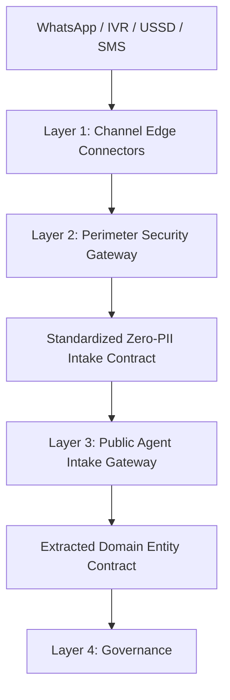

# Step 4.1: Multichannel Ingress & Modality Convergence Verification

> Sequence authority: [roadmap.md](../roadmap.md).

## 1. Scope

This record verifies that carrier-specific ingress converges on the Layer 3 intake boundary without weakening the established layer responsibilities. Connector and modality behavior is defined in [Step 3.4](./step3.4_layer3_intake_gateway_and_connectors.md); shared perimeter controls are defined in [Step 3.2](./step3.2_security_and_ingestion_firewalls.md).

## 2. Channel Ingress Verification

The verification table captures each channel's transport rail, supported modality, and invariants that must hold before an event enters the Layer 3 intake boundary.

| Channel | Transport rail | Modality support | Invariants |
| :--- | :--- | :--- | :--- |
| **WhatsApp** | HTTPS webhooks over Meta Graph API / authorized BSPs | **Text:** unstructured regional natural-language messages from smartphone keypads. **Audio:** recorded voice notes referenced by media stream metadata. | Validate each modality independently. Audio pointers and text bodies are mutually exclusive; empty or mixed-modality payloads are rejected at the edge before Layer 2 perimeter canonicalization. |
| **IVR telephony** | SIP Trunk / SS7 telephony gateways | Dedicated voice-call recordings captured from interactive telephony sessions. | Recording references must be signed and call duration bounded between 1 and 600 seconds. Keypad selections follow the structured path, not speech extraction. |
| **USSD** | Cellular SS7 / SIGTRAN signaling frames | Structured concatenated digit strings (for example, `1*2*101`) paired with network shortcodes (for example, `*147#`). | Input is bounded to 64 characters, mapped deterministically, and restricted to structured signaling payloads; it is never treated as free-form natural language. |
| **SMS** | Transactional SMS webhook rails | Plaintext message-only events carrying a unique carrier message identifier and message metadata. | Validate carrier message identity, preserve the text modality, and route the event through the same standardized intake and zero-PII perimeter controls as other channels. |

## 3. Modality Convergence Verification

This phase verifies that every channel and modality converges on the same zero-PII intake boundary while preserving its expected structure, perception path, confidence, and outbound delivery. A confidence score of at least `0.85` makes a claim eligible for automated governance evaluation; eligibility and uniqueness remain separate governance checks.

| Channel and modality | Structure level | Perception path | Expected token format | Expected confidence | Target delivery protocol |
| :--- | :--- | :--- | :--- | :--- | :--- |
| **WhatsApp (text)** | Free text | SLM entity extraction | 64-character hexadecimal SHA-256 HMAC | $\ge 0.85$ (eligible for automated governance evaluation) | WhatsApp template Markdown card |
| **WhatsApp (audio)** | Free text | Speech ASR followed by SLM entity extraction | 64-character hexadecimal SHA-256 HMAC | $\ge 0.85$ (transcribed claim; eligible for automated governance evaluation) | WhatsApp template Markdown card |
| **IVR voice (audio)** | Free text | Speech ASR followed by SLM entity extraction | 64-character hexadecimal SHA-256 HMAC | $\ge 0.85$ (transcribed claim; eligible for automated governance evaluation) | Pre-signed TTS playback stream |
| **USSD (keypress)** | Menu selection | Deterministic fast-path mapping, bypassing SLM inference | 64-character hexadecimal SHA-256 HMAC | $1.00$ (deterministic mapping) | GSM 7-bit plaintext string, at most 160 characters |
| **SMS (text)** | Free text | SLM entity extraction | 64-character hexadecimal SHA-256 HMAC | $\ge 0.85$ (eligible for automated governance evaluation) | TRAI DLT transactional SMS notice |

| Input modality | Failure handling |
| :--- | :--- |
| **Structured menu or DTMF** | Route valid selections through deterministic mapping; malformed selections follow the structured-input error path and are not sent through speech extraction. |
| **Audio** | Decoding failures and transcription timeouts use low-confidence handling (for example, confidence `0.40`) and enter the normal governance recovery path. |
| **Free text** | Low-confidence or incomplete extraction may trigger clarification only when the channel supports multi-turn follow-up. |

### 3.1 Convergence Invariants

- Every supported ingress channel must reach the same standardized intake boundary after Layer 2 canonicalization.
- Carrier-specific payloads must not bypass the Layer 2 zero-PII boundary or the Layer 3 public intake surface.
- A modality failure is an inability to process an otherwise ordinary input in its expected format—for example, audio that cannot be decoded or transcribed, or a malformed structured menu/DTMF selection. Handle these through the modality's normal failure path (such as low-confidence recovery for audio or the structured-input error path for menu selections); do not classify them as adversarial by default. Escalate to the security queue only when the perimeter or ingestion firewall explicitly detects a threat.
- Recovery behavior is channel-aware: channels that support multi-turn interaction may request clarification, while low-confidence USSD interactions go directly to human caseworker review because USSD cannot support re-prompts.

## 4. Perimeter and Boundary Assertions

For every carrier path, verify authentication, rate limiting, and zero-cleartext-PII handling against the [Layer 2 perimeter requirements in Step 3.2](./step3.2_security_and_ingestion_firewalls.md). Assert that the `Layer 2 output` contains no cleartext PII before it reaches `Layer 3`. Verify that the *Extracted Domain Entity Contract* is the only handoff from Layer 3 to Layer 4, as defined in the [channel-to-governance boundary architecture in Step 3.4](./step3.4_layer3_intake_gateway_and_connectors.md); carrier-specific payloads must not bypass either boundary. Low-confidence extraction failures are governance outcomes handled under the [Layer 4 governance routing rules in Step 3.3](./step3.3_layer4_orchestrator_brain.md), not security violations, unless the [perimeter threat firewall](./step3.2_security_and_ingestion_firewalls.md) explicitly flags adversarial input.

## 5. Acceptance Criteria

The integration simulation must verify that:

- Each channel-and-modality row in the convergence matrix follows the expected structure level and perception path.
- Every path emits an exact 64-character hexadecimal SHA-256 HMAC token, with no cleartext citizen identifier crossing the Layer 2 boundary.
- Free-text and transcribed claims at or above `0.85` become eligible for automated governance evaluation; this score does not bypass separate eligibility and uniqueness checks. USSD keypresses use deterministic mapping, bypass SLM inference, and carry the contract's fixed confidence baseline `1.00`, not a calibrated model score.
- Outbound delivery matches the target protocol in the matrix, including the 160-character GSM 7-bit USSD limit.
- Modality failures follow the documented low-confidence or clarification recovery path rather than being treated as adversarial unless explicitly flagged.
- Every supported channel reaches the shared standardized intake boundary; invalid carrier events fail at the perimeter or connector boundary, and no channel-specific path bypasses zero-PII assertions.
