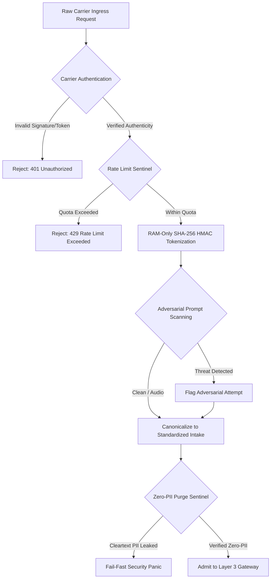
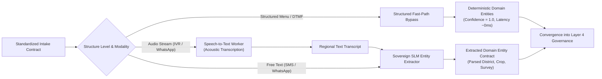
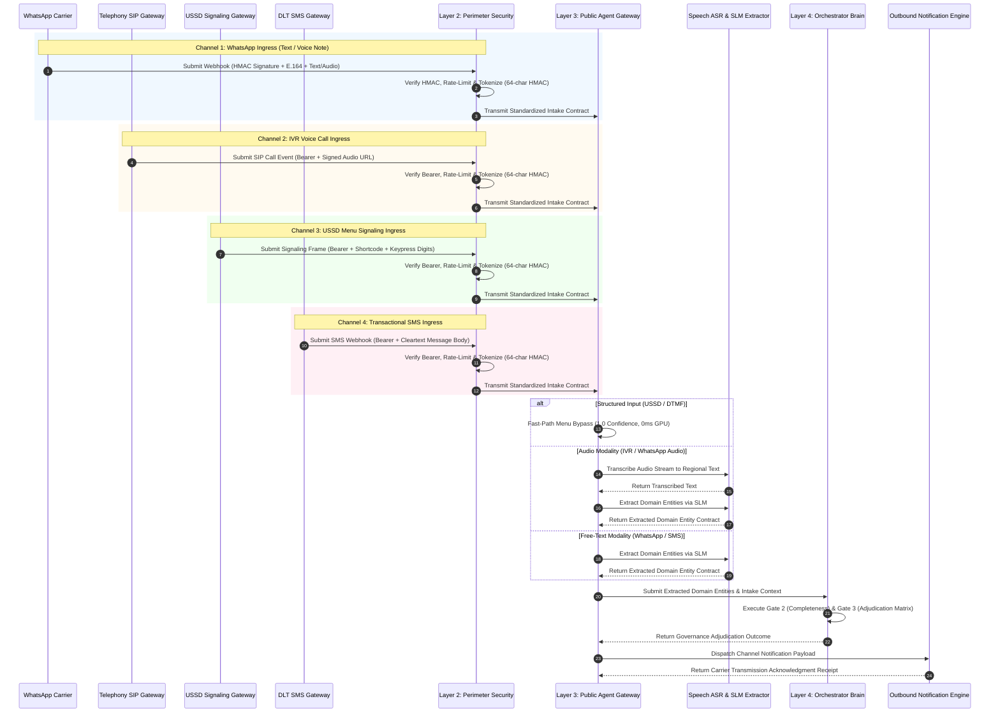

# Step 4.1: Multichannel Ingress & Modality Convergence Architecture

## 1. Executive Summary & Verification Scope

This document defines the architectural specifications and verification model for **Phase 4, Step 4.1: Multichannel Ingress & Modality Convergence** within the AgriStack Zero-Trust Digital Public Infrastructure (DPI) Orchestrator.

The primary objective of Step 4.1 is to validate the seamless convergence of heterogeneous telecommunication channels and input modalities into a unified, zero-PII canonical contract (see architectural foundation in [step3.4_layer3_intake_gateway_and_connectors.md](./step3.4_layer3_intake_gateway_and_connectors.md)). Regardless of whether a farmer interacts via regional voice calls over telephony SIP trunks, multimedia messaging, feature-phone cellular USSD signaling, or transactional SMS, the system must enforce uniform perimeter security, eliminate cleartext personally identifiable information (PII) at the edge, and normalize data into the *Standardized Intake Contract* for downstream governance adjudication.

```
                   INCOMING TELECOM TRANSPORT RAILS
  ┌───────────────────┬───────────────────┬───────────────────┬───────────────────┐
  │     WhatsApp      │     IVR Voice     │     USSD Menu     │     DLT SMS       │
  │  (Text & Voice)   │   (Audio Stream)  │   (Digit String)  │   (Cleartext)     │
  └─────────┬─────────┴─────────┬─────────┴─────────┬─────────┴─────────┬─────────┘
            │                   │                   │                   │
            ▼                   ▼                   ▼                   ▼
  ┌───────────────────────────────────────────────────────────────────────────────┐
  │                     LAYER 2: PERIMETER SECURITY GATEWAY                       │
  │  1. Carrier Transport Authentication (HMAC-SHA256 Signatures & Bearer Tokens) │
  │  2. Token-Bucket Rate Limiter (Per-Caller Volatile Quota Sentinel)            │
  │  3. Zero-Trust Identity Tokenizer (RAM-Only SHA-256 HMAC Pseudonymization)    │
  │  4. Zero-PII Purge Sentinel (Fail-Fast Verification & Leakage Blocking)       │
  │  5. Adversarial Prompt Firewall (Prompt Injection & Hijack Scanning)         │
  │  6. Ingress Canonicalizer (Transforms Carrier Schemas to Canonical Form)     │
  └───────────────────────────────────────┬───────────────────────────────────────┘
                                          │
                                          ▼
                      [ Standardized Intake Contract (Zero-PII) ]
                                          │
                                          ▼
  ┌───────────────────────────────────────────────────────────────────────────────┐
  │                 LAYER 3: PUBLIC AGENT INTAKE GATEWAY SURFACE                  │
  │                                                                               │
  │   [ Gate 1: Modality Evaluation & Perception Convergence ]                    │
  │   ├─ Structured Keypress Bypass (USSD / DTMF) ──> Zero-Latency Determinism    │
  │   ├─ Voice Audio Streams (IVR / WhatsApp)     ──> Speech ASR Transcription    │
  │   └─ Regional Free-Text (SMS / WhatsApp / ASR)──> Sovereign SLM Extraction    │
  └───────────────────────────────────────┬───────────────────────────────────────┘
                                          │
                                          ▼
                      [ Extracted Domain Entity Contract ]
                                          │
                                          ▼
  ┌───────────────────────────────────────────────────────────────────────────────┐
  │                 LAYER 4: DPI ORCHESTRATION & GOVERNANCE BRAIN                 │
  │  - Gate 2: Intake Validation & Multi-Turn Correction Dialogue Loops           │
  │  - Gate 3: Deterministic Policy Adjudication Matrix                           │
  │  - Outbound Carrier Transmission Acknowledgment Receipt                       │
  └───────────────────────────────────────────────────────────────────────────────┘
```

---

## 2. Multichannel Ingress Topography

The system accommodates the vast diversity of rural Indian telecommunications infrastructure across four primary carrier protocols:

### 2.1 WhatsApp Messaging Channel
* **Transport Rail:** HTTPS Webhooks over Meta Graph API / Authorized Business Solution Providers (BSPs).
* **Ingress Contract:** *WhatsApp Ingress Contract*.
* **Dual-Modality Support:**
  * **Text Modality:** Unstructured regional natural language text messages submitted directly from smartphone keypads.
  * **Audio Modality:** Voice note recordings stored as audio media streams, accompanied by explicit audio duration metadata.
* **Modality Invariant:** Ingress contracts strictly mandate mutual exclusivity between audio pointers and text bodies. Mixed-modality or empty payloads are rejected at the edge to preserve deterministic downstream parsing.

### 2.2 IVR Telephony Voice Channel
* **Transport Rail:** SIP Trunk / SS7 Telephony Gateways.
* **Ingress Contract:** *IVR Voice Ingress Contract*.
* **Modality Support:** Dedicated voice call recordings captured from interactive telephony sessions.
* **Acoustic Bounds:** Enforces signed recording references and bounds call duration between 1 second and 600 seconds, defending downstream transcription resources from denial-of-service starvation.

### 2.3 USSD Cellular Menu Signaling Channel
* **Transport Rail:** Cellular SS7 / SIGTRAN signaling frames over mobile network operators.
* **Ingress Contract:** *USSD Ingress Contract*.
* **Modality Support:** Structured concatenated digit strings (e.g., `1*2*101`) paired with network routing shortcodes (e.g., `*147#`).
* **Protocol Constraints:** Operates entirely over signaling channels without requiring data connectivity or smartphones, strictly bounded to 64 characters based on menu depth tree calculations.

### 2.4 Transactional SMS Channel
* **Transport Rail:** TRAI DLT-registered transactional SMS webhooks.
* **Ingress Contract:** *SMS Ingress Contract*.
* **Modality Support:** Plaintext cellular short messages up to 1000 characters.
* **Protocol Invariants:** Mandatory unique carrier message identifiers for transaction deduplication and standard E.164 phone numbering.

---

## 3. Layer 2 Perimeter Security Traversal

Every raw ingress payload must traverse a six-stage perimeter security barrier before admission into the internal agent runtime:



### 3.1 Carrier Transport Authentication
* **Webhook Signature Verification:** Verifies carrier payload signatures using constant-time cryptographic comparisons against pre-shared application secrets, preventing replay attacks and payload tampering.
* **Bearer Token Validation:** Validates pre-shared bearer credentials for telecommunication gateway callbacks (IVR SIP trunks, USSD gateways, SMS aggregators).

### 3.2 Token-Bucket Rate Limiter
* Enforces request quotas in volatile memory keyed by caller identity to throttle malicious floods and misconfigured carrier retries.
* Exceeding threshold allowances results in immediate rejection before expensive perception or language models are engaged.

### 3.3 Zero-Trust Identity Tokenization
* **Volatile RAM Invariant:** Caller phone numbers are pseudonymized in volatile memory using a high-entropy secret cryptographic pepper.
* **One-Way Digest:** Produces an irreversible 64-character SHA-256 HMAC citizen token.
* **Zero Persistence of Cleartext Identifiers:** Cleartext phone numbers are strictly prohibited from touching disk, analytical logs, or internal queues.

### 3.4 Zero-PII Purge Sentinel
* Deep-scans every field of the normalized contract prior to Layer 3 handoff.
* Asserts that no phone numbers, Aadhaar numbers, or unredacted citizen identifiers persist within downstream attributes.

### 3.5 Adversarial Prompt Injection Scanning
* Pre-inspects all cleartext bodies for prompt injection, system instruction overrides, jailbreak phrases, and delimiter hijacking.
* If threat signatures are detected, the payload is flagged to neutralize downstream automated processing while preserving auditability.

---

## 4. Modality Convergence & Perception Routing (Layer 3)

Layer 3 encapsulates modality perception, shielding downstream governance engines from transport idiosyncrasies:



### 4.1 Fast-Path Structured Bypass
* **Target Channels:** USSD menu digit selections and IVR keypad DTMF signaling.
* **Architectural Advantage:** Deterministic keypress navigation bypasses artificial intelligence extraction entirely.
* **Impact:**
  * Eliminates approximately 800ms of GPU inference latency per interaction.
  * Completely eliminates AI hallucinations for fixed menu choices.
  * Delivers a deterministic confidence score of 1.0.

### 4.2 Acoustic Speech-to-Text Transcription
* **Target Channels:** IVR telephony voice recordings and WhatsApp voice notes.
* **Perception Worker:** Speech-to-Text Worker (Bhashini ASR) converts audio stream recordings into regional text transcripts based on caller locale.
* **Resilience Fallback:** If audio streams fail decoding or experience transport timeouts, the perception worker yields a safe fallback contract with low confidence (0.40) to trigger clarification dialog loops.

### 4.3 Sovereign SLM Domain Entity Extraction
* **Target Modalities:** Free-text messages (SMS, WhatsApp text) and post-ASR audio transcripts.
* **Extraction Worker:** Sovereign Small Language Model (SLM) extracts key agricultural claim entities:
  * Claim District
  * Crop Variety
  * Cadastral Land Survey Number
* **Confidence Scoring:** Assigns a mathematical confidence metric to drive the downstream governance routing matrix.

---

## 5. End-to-End Multichannel Convergence Sequence

The following sequence details how all four channels simultaneously converge through perimeter security into Layer 3 intake and Layer 4 governance:



---

## 6. Verification & Simulation Invariants

To guarantee that multichannel ingress convergence operates correctly under automated integration simulation, the test suite must enforce the following invariants:

| Channel & Modality | Structure Level | Perception Path | Expected Token Format | Expected Confidence | Target Delivery Protocol |
| :--- | :--- | :--- | :--- | :--- | :--- |
| **WhatsApp (Text)** | Free-Text | SLM Entity Extraction | 64-char Hex SHA-256 HMAC | $\ge 0.85$ (Eligible Claim) | WhatsApp Template Markdown Card |
| **WhatsApp (Audio)** | Free-Text | Speech ASR + SLM | 64-char Hex SHA-256 HMAC | $\ge 0.85$ (Transcribed Claim) | WhatsApp Template Markdown Card |
| **IVR Voice (Audio)** | Free-Text | Speech ASR + SLM | 64-char Hex SHA-256 HMAC | $\ge 0.85$ (Transcribed Claim) | Pre-Signed TTS Playback Stream |
| **USSD (Keypress)** | Menu Selection | Fast-Path Bypass | 64-char Hex SHA-256 HMAC | $1.00$ (Deterministic Bypass) | GSM 7-bit Plaintext String ($\le 160$ chars) |
| **SMS (Text)** | Free-Text | SLM Entity Extraction | 64-char Hex SHA-256 HMAC | $\ge 0.85$ (Eligible Claim) | TRAI DLT Transactional SMS Notice |

### 6.1 Invariant Validation Rules
1. **Zero-PII Token Symmetry:** Regardless of channel, the tokenized citizen identifier must be exactly 64 hexadecimal characters, deterministically derived from the originating phone number.
2. **Zero Cleartext Leakage:** Raw caller phone numbers must never appear in unprocessed input content, extracted entity maps, or notification requests.
3. **Receipt Acknowledgment Integrity:** Every successful flow must conclude with a valid *Carrier Transmission Acknowledgment Receipt* matching the originating carrier identifier pattern (e.g., `wamid.` for WhatsApp, `sip-call-` for IVR, `ussd-sig-` for USSD, `sms-dr-` for SMS).
4. **Modality Boundary Adherence:** Audio streams must preserve valid pre-signed recording URLs until ASR transcription, while text payloads must have acoustic references stripped.

---

## 7. Architectural Consequences & Trade-Offs

### Positive Consequences
* **Decoupled Perception:** Layer 4 governance logic remains completely agnostic to how data arrived (voice, keypad, WhatsApp, or SMS).
* **Zero-PII Isolation:** Telecommunication identifiers are quarantined at Layer 2; internal agent processing operates on irreversible pseudonyms.
* **Latency Optimization:** USSD and DTMF bypass paths eliminate expensive AI inference loops for deterministic menu interactions.
* **Graceful Degradation:** Audio and text parsing failures fall back to structured clarification prompts rather than crashing the interaction loop.

### Trade-Offs & Mitigations
* **Acoustic Model Dependency:** Voice channels depend on Speech-to-Text accuracy for low-resource regional dialects. *Mitigation:* Fallback mechanisms detect low-confidence transcripts and trigger progressive clarification turns.
* **Carrier Payload Variety:** Distinct webhook formats require dedicated edge adapters. *Mitigation:* Layer 2 Canonicalizer normalizes all carrier variants into a single strict schema at the perimeter boundary.
