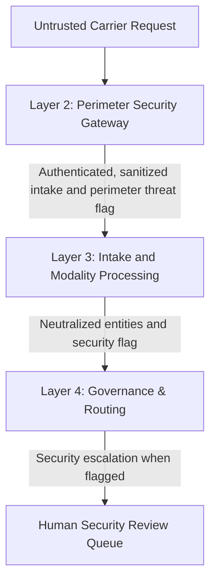

# Step 4.2: Security Firewall & Zero-Trust PII Verification

> Sequence authority: [roadmap.md](../roadmap.md).

## 1. Scope

This record verifies the security controls and their end-to-end effect across the architecture. The security policy is defined in [Step 3.2](./step3.2_security_and_ingestion_firewalls.md), and the channel convergence boundary is verified in [Step 4.1](./step4.1_multichannel_ingress_and_modality_convergence.md). Layer 3 and Layer 4 remain distinct: intake processing identifies and neutralizes unsafe input; governance applies the deterministic routing decision.



## 2. Carrier Authentication Verification

Verify that each carrier path honors its own transport-level authentication contract before any payload parsing. The fail-closed rule is the same across channels, but the mechanism differs: WhatsApp primarily uses a raw-body webhook signature check, while IVR, USSD, and SMS callback flows may additionally use bearer-token validation when the carrier contract requires it.

### 2.1 Channel-Specific Authentication Matrix

| Channel | Primary authentication mechanism | Required verification |
| :--- | :--- | :--- |
| **WhatsApp** | Raw-body `X-Hub-Signature-256` HMAC check | Validate the signature against the exact raw request bytes before payload decoding or canonicalization. There is no bearer-token check in the standard WhatsApp webhook contract unless a platform-specific BSP adapter adds one. |
| **IVR / SIP** | Bearer token in `Authorization` header, plus raw-body integrity signature | Require a valid bearer token and a valid signed body; reject missing or malformed values before any audio payload parsing. |
| **USSD / SMS** | Caller token or bearer credential plus signed callback body | Enforce constant-time comparison and signature verification before request normalization. |

For signed callbacks, verify that the signature check in [Step 3.2: Security & Ingestion Firewalls](./step3.2_security_and_ingestion_firewalls.md) uses the raw request body before payload parsing and rejects invalid or missing signatures. For bearer-authenticated channels, the token comparison must also use constant-time comparison rather than short-circuit equality checks.

### 2.2 Carrier Transport Authentication & Quota Sentinels

* **Webhook Signature Verification (WhatsApp / BSPs):** Compute a SHA-256 HMAC over the raw request byte stream using the configured application secret and compare it against the carrier signature header with constant-time comparison. This defeats timing side-channel attacks and prevents payload tampering before canonicalization.
* **Bearer Credential Verification (IVR SIP / USSD / SMS):** Enforce constant-time verification of pre-shared authorization tokens on carrier callback endpoints when the channel contract requires bearer auth.
* **Fail-Fast Rejection:** Any request with a missing, malformed, or mismatched signature or bearer token is rejected immediately at the transport edge.
* **Caller-Scoped Quota Enforcement:** Track request budgets in volatile memory per caller using a token-bucket algorithm and reject over-quota traffic before speech transcription or model extraction begins.

Example verification pattern for bearer-authenticated callback channels:

```text
if request.headers["Authorization"] is missing:
    fail_closed()

provided_token = parse_bearer_token(request.headers["Authorization"])
if not constant_time_equals(provided_token, configured_secret):
    fail_closed()

raw_body = request.raw_body_bytes()
if not signature_present(request.headers["X-Hub-Signature-256"]):
    fail_closed()

expected_sig = hmac_sha256(configured_secret, raw_body)
if not constant_time_equals(request.headers["X-Hub-Signature-256"], "sha256=" + expected_sig):
    fail_closed()

continue_processing()
```

WhatsApp follows the signature-only path unless the deployment adds a separate BSP-specific bearer check. In a valid request, the required checks for that channel pass. In an invalid or tampered request, the mismatch causes the callback to fail closed before any payload parsing or downstream processing occurs.

## 3. Rate-Limit Verification

* **Caller-Scoped Throttling:** Rate limits are tracked per caller identity in volatile memory using a token-bucket algorithm defined by a sustained refill rate and burst capacity.
* **Early Termination Invariant:** Rate-limiting evaluation executes prior to speech transcription or language model entity extraction, protecting sovereign AI compute clusters from resource exhaustion.
* **Zero-PII Throttling Audit Logs:** When a caller exceeds their quota, the system logs the event using only the ephemeral session identifier—never recording the raw caller phone number.

## 4. Zero-PII Verification

### 4.1 RAM-Only Cryptographic Tokenization
* **One-Way Pseudonymization:** The originating caller phone number is combined with a high-entropy environment pepper secret and hashed via SHA-256 HMAC in volatile memory.
* **64-Character Digest Invariant:** The resulting citizen identifier is strictly a 64-character hexadecimal string.
* **Zero Cleartext Persistence:** The original phone number is discarded immediately after tokenization and never leaves the Layer 2 perimeter in cleartext.

### 4.2 Two-Tier PII Purge Sentinel
The PII Purge Sentinel enforces both active sanitization and defensive verification:
1. **Active Free-Text Redaction:** Scans incoming message bodies and speech transcripts for international phone numbers (E.164 format), 10-digit Indian mobile numbers, and 12-digit national identity numbers (Aadhaar UID patterns with or without spaces), replacing all occurrences with `[REDACTED]`.
2. **Defensive Zero-PII Contract Assertion:** Before any *Standardized Intake Contract* is emitted from Layer 2, the sentinel inspects every field to assert that:
   * The citizen identifier is exactly 64 hexadecimal characters.
   * Neither the citizen identifier nor the unprocessed input content contains any residual phone number or Aadhaar number patterns.
   * If any cleartext PII is detected, the sentinel raises a fail-fast security exception, aborting the transaction before data reaches Layer 3 or persistent storage.

## 5. Adversarial Input Security Routing

The threat categories and perimeter screening policy are defined in Step 3.2. When a threat is detected at Layer 2 or during Layer 3 intake processing:

- **Perimeter Detection:** Layer 2 rejects the request or flags it as adversarial before canonicalization.
- **Confidence Neutralization:** Layer 3 sets the adversarial-attempt flag to `True` and forces extraction confidence to `0.0`.
- **Entity Stripping:** Layer 3 clears all extracted domain entities (`{}`) so attacker-supplied parameters cannot influence downstream registry lookups.
- **Conversational Loop Bypass:** Gate 2, the Intake Validation Gate, detects the adversarial flag and immediately skips multi-turn clarification and conversational re-prompting.
- **Mandatory Security Escalation:** Gate 3, the Deterministic Policy Adjudication Matrix, intercepts the zero-confidence adversarial result and routes it directly to manual caseworker security review with the reason code `ADVERSARIAL_ATTEMPT_FLAGGED`.
- **Escalation Tracking:** The escalation creates a dedicated case identifier so the security review can be tracked and audited.

Detection categories and screening policy remain defined in [Step 3.2](./step3.2_security_and_ingestion_firewalls.md). This phase verifies that threats from each of its five categories are neutralized and that the adversarial flag, zero confidence, cleared entities, bypass decision, escalation reason, and case identifier survive the Layer 2-to-Layer 3-to-Layer 4 boundary without reintroducing cleartext content or bypassing the security review queue.

## 6. Verification Matrix

| Security dimension | Test case | Required result |
| :--- | :--- | :--- |
| **Carrier authentication** | Valid, invalid, missing, and malformed signatures or bearer credentials | Valid credentials pass; all other cases fail closed before payload processing. |
| **Bearer-token comparison** | Same-length guesses differing at the first or a later character | Token-comparison work does not depend on the mismatch position; the test does not assert equal total request latency. |
| **Rate limiting** | Caller exceeds its quota | Request is rejected before expensive downstream processing. |
| **Zero-PII tokenization** | Valid caller identifier | Output token is a 64-character hexadecimal value; the original identifier does not cross the boundary. |
| **Zero-PII purge** | Phone-number or Aadhaar patterns in carrier metadata or message content | Sanitized output contains no residual patterns; a failed assertion aborts the handoff. |
| **PII persistence** | Cleartext identifiers in logs, persistent records, analytics, or internal queues | No cleartext identifiers are retained. |
| **Adversarial handling** | Representative input from each of the five threat categories, flagged at the perimeter or during intake processing | The adversarial flag is `True`, confidence is `0.0`, entities are `{}`, Gate 2 skips multi-turn re-prompting, and Gate 3 routes directly to manual security review with reason code `ADVERSARIAL_ATTEMPT_FLAGGED` and a dedicated case identifier. |

## 7. Acceptance Criteria

* **Defense-in-Depth:** Combining perimeter regex screening, SLM confidence neutralization, and deterministic Gate 3 security routing ensures that prompt hijacks cannot trigger automated treasury disbursements even if one layer is partially bypassed.
* **DPDP Act Compliance by Construction:** Enforcing RAM-only tokenization and defensive zero-PII assertions guarantees that downstream services, logs, and databases never handle raw citizen phone numbers or Aadhaar numbers.
* **Attacker Containment:** Bypassing conversational re-prompts on adversarial attempts denies attackers interactive feedback loops while preserving the escalation reason and dedicated case identifier in the caseworker security queue.
