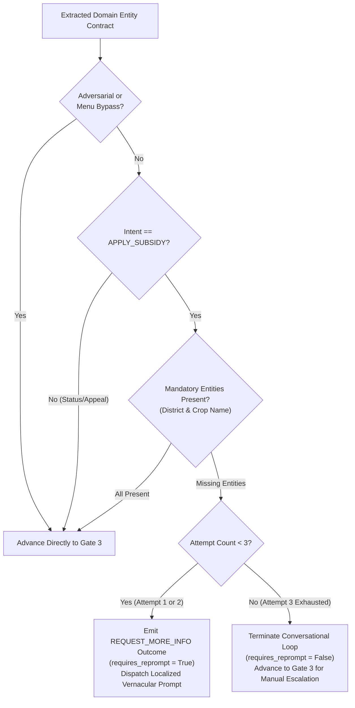
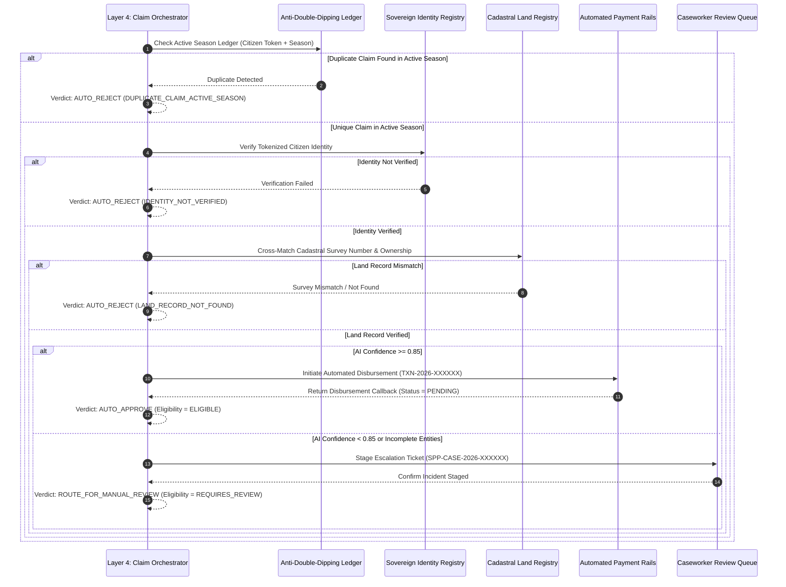

# Step 4.3: Three-Gate Governance & Conversational Loop Verification Architecture

## 1. Executive Summary & Architectural Scope

This document specifies the end-to-end orchestration verification architecture for **Phase 4, Step 4.3: Three-Gate Governance & Conversational Loop Verification** within the AgriStack Zero-Trust Digital Public Infrastructure (DPI) Orchestrator.

The citizen welfare orchestration brain enforces a strict **Three-Gate Governance Architecture** that decouples modality perception (Gate 1), conversational completeness validation (Gate 2), and deterministic policy adjudication (Gate 3). This three-stage separation ensures that unstructured regional voice calls and text messages are progressively refined into complete domain contracts before engaging sovereign DPI registries, while bounding conversational retries to prevent citizen frustration or infinite loops.

```
                ┌───────────────────────────────────────────────────────┐
                │            STANDARDIZED INTAKE CONTRACT               │
                │         (64-Char HMAC Token + Zero-PII Payload)       │
                └───────────────────────────┬───────────────────────────┘
                                            │
                                            ▼
  ┌───────────────────────────────────────────────────────────────────────────────────┐
  │                 GATE 1: INGRESS MODALITY & STRUCTURE GATE                         │
  │  - Fast-Path Structured Bypass (USSD / DTMF) ──> Confidence = 1.0, Latency ~0ms  │
  │  - Acoustic Speech Transcription + Sovereign SLM Entity Extraction                │
  └─────────────────────────────────────────┬─────────────────────────────────────────┘
                                            │
                                            ▼
                      [ Extracted Domain Entity Contract ]
                                            │
                                            ▼
  ┌───────────────────────────────────────────────────────────────────────────────────┐
  │             GATE 2: INTAKE COMPLETENESS & CONVERSATIONAL LOOP GATE                │
  │  - Evaluates Mandatory Subsidy Entities (Claim District & Crop Variety)           │
  │  - Attempts 1 & 2 (Missing Entities) ──> REQUEST_MORE_INFO (Localized Reprompt)   │
  │  - Attempt 3 Exhaustion (Cap = 3)    ──> Advance to Gate 3 for Manual Escalation │
  └─────────────────────────────────────────┬─────────────────────────────────────────┘
                                            │
                                            ▼
  ┌───────────────────────────────────────────────────────────────────────────────────┐
  │            GATE 3: DETERMINISTIC POLICY ADJUDICATION MATRIX                       │
  │  - Cross-Matches Sovereign DPI Registries (AgriStack Land + MOSIP Identity)       │
  │  - Evaluates Anti-Double-Dipping Active Season Ledger                             │
  │  ├─ [Branch A] AUTO_APPROVE             ──> Automated Payment Clearance Rails     │
  │  ├─ [Branch B] ROUTE_FOR_MANUAL_REVIEW  ──> Caseworker Incident Staging Queue     │
  │  └─ [Branch C] AUTO_REJECT              ──> Deterministic Rejection Notice        │
  └───────────────────────────────────────────────────────────────────────────────────┘
```

---

## 2. Gate 1: Ingress Modality & Structure Gate

Gate 1 governs perception routing based on the structural determinism of the incoming citizen interaction:

### 2.1 Fast-Path Structured Menu Bypass
* **Trigger Condition:** Incoming payload exhibits a structured menu selection level (cellular USSD keypad signaling or telephony DTMF keypresses).
* **Execution Behavior:** Bypasses acoustic transcription and language model inference entirely, mapping the keypad selection deterministically to canonical agricultural claim entities.
* **Architectural Invariants:**
  * Assigns a deterministic AI confidence score of `1.0`.
  * Sets the structured menu bypass indicator to `True`.
  * Eliminates approximately 800ms of GPU inference latency and completely prevents model hallucinations.

### 2.2 Unstructured Speech & Free-Text Perception
* **Trigger Condition:** Incoming payload is unstructured free text (WhatsApp chat, SMS) or voice audio (IVR telephony, WhatsApp voice note).
* **Execution Behavior:**
  * Audio streams are first transcribed into regional text via Speech-to-Text Workers (Bhashini ASR).
  * Regional text transcripts and direct text messages are parsed by sovereign Small Language Models (SLM) to extract domain parameters (`district`, `crop_name`, `survey_number`) and classify citizen intent (`APPLY_SUBSIDY`, `CHECK_STATUS`, `SUBMIT_APPEAL`).

---

## 3. Gate 2: Intake Completeness & Multi-Attempt Conversational Loop

To qualify for automated benefit adjudication under seasonal agricultural subsidy schemes, a citizen claim must provide mandatory domain entities—specifically the **Claim District** and **Crop Variety**. Gate 2 manages missing entity detection and bounded multi-turn clarification loops:



### 3.1 Three-Attempt Loop Cap Invariant
Rural callers interacting over voice or messaging frequently omit required details on their initial turn (e.g., stating crop damage without specifying their district). Gate 2 enforces a strict **3-attempt conversational cap**:
* **Attempts 1 and 2 (Interactive Clarification):** When mandatory entities are missing on turn 1 or turn 2, the orchestrator suspends adjudication, emits a `REQUEST_MORE_INFO` governance action (`requires_reprompt = True`), and dispatches a localized vernacular prompt specifying the exact missing fields.
* **Multi-Turn Recovery:** If the citizen supplies the missing parameters on turn 2 or turn 3, the merged entity contract satisfies Gate 2 completeness and advances immediately to Gate 3 for straight-through adjudication.
* **Attempt 3 Exhaustion (Loop Termination):** If mandatory parameters remain missing on attempt 3 (`attempt_count = 3`), Gate 2 terminates the conversational loop (`requires_reprompt = False`) and forwards the incomplete claim to Gate 3, which routes the case to a human caseworker (`ROUTE_FOR_MANUAL_REVIEW`). This prevents citizens from being trapped in infinite automated questioning loops.

---

## 4. Gate 3: Deterministic Policy Adjudication Matrix

Once a claim passes Gate 2 (either complete or exhausted after 3 attempts), Gate 3 executes a deterministic policy decision matrix across sovereign Digital Public Infrastructure (DPI) registries:



### 4.1 Tri-State Governance Routing Rules

| Adjudication Outcome | Trigger Conditions | Downstream Execution & Side Effects | Eligibility Status |
| :--- | :--- | :--- | :--- |
| **`AUTO_APPROVE`** (Automated Payout) | AI confidence $\ge 0.85$, unique active-season claim, verified identity token, and verified cadastral land parcel | Generates transaction ID (`TXN-2026-*`), initiates disbursement on payment clearance rails (`DisbursementStatus.PENDING`), and dispatches approval receipt | `ELIGIBLE` |
| **`ROUTE_FOR_MANUAL_REVIEW`** (Caseworker Escalation) | AI confidence $< 0.85$, incomplete entities after 3 attempts, or adversarial threat flag | Generates escalation ticket (`SPP-CASE-2026-*`), stages incident in social protection case queue, and dispatches review notification | `REQUIRES_REVIEW` |
| **`AUTO_REJECT`** (Automated Rejection) | Duplicate active-season claim (`DUPLICATE_CLAIM_ACTIVE_SEASON`), unverified identity (`IDENTITY_NOT_VERIFIED`), or land mismatch (`LAND_RECORD_NOT_FOUND`) | Terminates claim processing, records explicit rejection reason code, and dispatches transparent rejection explanation | `INELIGIBLE` |

---

## 5. End-to-End Verification Matrix

The automated simulation test suite verifies all three governance gates and branching paths:

1. **Gate 1 Modal Convergence & Bypass:** Verifies USSD structured fast-path (`confidence = 1.0`, `is_structured_menu_bypass = True`) vs. audio/text NLU extraction.
2. **Gate 2 Multi-Turn Conversational Loop (Attempts 1 $\rightarrow$ 2 $\rightarrow$ 3):**
   * Verifies turn 1 and turn 2 missing-entity reprompts (`REQUEST_MORE_INFO`, `requires_reprompt = True`).
   * Verifies turn 2 conversational recovery advancing to `AUTO_APPROVE`.
   * Verifies turn 3 exhaustion terminating reprompts (`requires_reprompt = False`) and escalating to caseworker review (`ROUTE_FOR_MANUAL_REVIEW`).
3. **Gate 3 Tri-State Policy Adjudication Matrix:**
   * Verifies straight-through automated payout approval (`AUTO_APPROVE`) and payment rail callback generation.
   * Verifies low-confidence manual review escalation (`ROUTE_FOR_MANUAL_REVIEW`) and caseworker ticket staging.
   * Verifies deterministic auto-rejection across all three statutory rejection codes (`DUPLICATE_CLAIM_ACTIVE_SEASON`, `IDENTITY_NOT_VERIFIED`, `LAND_RECORD_NOT_FOUND`).

---

## 6. Architectural Consequences

### Positive Consequences
* **Guaranteed Termination:** The hard cap of 3 conversational attempts mathematically guarantees that no citizen interaction can enter an infinite clarification loop.
* **Deterministic Auditability:** Every automated approval or rejection is backed by verifiable registry lookups (identity, land records, season ledger) and explicit statutory reason codes.
* **Zero Hallucinated Disbursements:** Low-confidence AI extractions ($< 0.85$) are structurally barred from triggering treasury payouts and are deterministically routed to human caseworkers.
