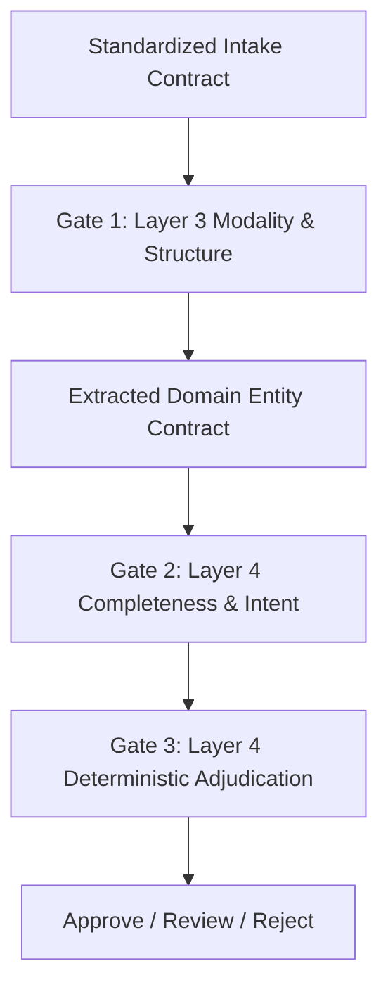

# Step 4.3: Three-Gate Governance & Conversational Loop Verification

## 1. Scope

This phase verifies the three-gate behavior and its boundary contracts. The governance architecture is defined in [Step 3.3](./step3.3_layer4_orchestrator_brain.md), the intake boundaries are defined in [Step 3.4](./step3.4_layer3_intake_gateway_and_connectors.md), and the authoritative lifecycle and financial state rules are defined in [Step 2.2](./step2.2_governance_flows_and_state_transitions.md). This file contains verification scenarios only; it does not re-declare the canonical governance logic.

## 2. Gate 1: Modality and Structure

Verify that the structured USSD and DTMF paths produce the expected extracted-domain contract without engaging speech recognition or language-model extraction. The output must contain the canonical entity fields, modality metadata, and confidence values defined by the Layer 3 contract; for the deterministic path, confidence should be `1.0`.

Verify that audio and free-text inputs produce the same contract shape and preserve the same downstream governance semantics, with modality and confidence metadata retained. A decoding or transcription failure must use the defined low-confidence handling rather than being mislabeled as an adversarial input.

## 3. Gate 2: Completeness and Conversational Loop

Verify that non-claim intents follow their designated non-adjudication route. For `APPLY_SUBSIDY` claims, the mandatory fields are the canonical `DISTRICT`, `CROP_NAME`, and `SURVEY_NUMBER` fields defined in the Layer 4 gate contract.

### 3.1 Three-Attempt Loop Cap Invariant
Rural callers interacting over voice or messaging frequently omit required details on their initial turn (e.g., stating crop damage without specifying their district). Gate 2 enforces a strict **3-attempt conversational cap**:
* **Attempts 1 and 2 (Interactive Clarification):** For missing required fields, verify that attempts one and two request only the missing information and do not proceed to automatic adjudication.  When mandatory entities are missing on turn 1 or turn 2, the orchestrator suspends adjudication, emits a `REQUEST_MORE_INFO` governance action (`requires_reprompt = True`), and dispatches a localized vernacular prompt specifying the exact missing fields.
* **Multi-Turn Recovery:** If the citizen supplies the missing parameters on turn 2 or turn 3, the merged entity contract satisfies Gate 2 completeness and advances immediately to Gate 3 for straight-through adjudication.
* **Attempt 3 Exhaustion (Loop Termination):** Stop re-prompting and route to `INFO_REQUESTED` / `UNDER_REVIEW` for human handling. If mandatory parameters remain missing on attempt 3 (`attempt_count = 3`), Gate 2 terminates the conversational loop (`requires_reprompt = False`) and forwards the incomplete claim to Gate 3, which routes the case to a human caseworker (`ROUTE_FOR_MANUAL_REVIEW`). This prevents citizens from being trapped in infinite automated questioning loops.

## 4. Gate 3: Deterministic Adjudication

| Adjudication Outcome | Trigger Conditions | Downstream Execution & Side Effects | Eligibility Status |
| :--- | :--- | :--- | :--- |
| **`AUTO_APPROVE`** (Automated Payout) | AI confidence $\ge 0.85$, unique active-season claim, verified identity token, and verified cadastral land parcel | Generates transaction ID (`TXN-2026-*`), initiates disbursement on payment clearance rails (`DisbursementStatus.PENDING`), and dispatches approval receipt | `ELIGIBLE` |
| **`ROUTE_FOR_MANUAL_REVIEW`** (Caseworker Escalation) | AI confidence $< 0.85$, incomplete entities after 3 attempts, or adversarial threat flag | Generates escalation ticket (`SPP-CASE-2026-*`), stages incident in social protection case queue, and dispatches review notification | `REQUIRES_REVIEW` |
| **`AUTO_REJECT`** (Automated Rejection) | Duplicate active-season claim (`DUPLICATE_CLAIM_ACTIVE_SEASON`), unverified identity (`IDENTITY_NOT_VERIFIED`), or land mismatch (`LAND_RECORD_NOT_FOUND`) | Terminates claim processing, records explicit rejection reason code, and dispatches transparent rejection explanation | `INELIGIBLE` |

## 5. End-to-End Verification Matrix

The automated simulation test suite verifies all three governance gates and branching paths:

1. **Gate 1 Modal Convergence & Bypass:** Verifies USSD structured fast-path (`confidence = 1.0`, `is_structured_menu_bypass = True`) vs. audio/text NLU extraction.
2. **Gate 2 Multi-Turn Conversational Loop (Attempts 1 $\rightarrow$ 2 $\rightarrow$ 3):**
   * Verifies turn 1 and turn 2 missing-entity reprompts (`REQUEST_MORE_INFO`, `requires_reprompt = True`).
   * Verifies turn 2 conversational recovery advancing to `AUTO_APPROVE`.
   * Verifies turn 3 exhaustion terminating reprompts (`requires_reprompt = False`) and escalating to caseworker review (`ROUTE_FOR_MANUAL_REVIEW`).
3. **Gate 3 Tri-State Policy Adjudication Matrix:**
   * Verifies straight-through automated payout approval (`AUTO_APPROVE`) and payment rail callback generation.
   * Verifies low-confidence manual review escalation (`ROUTE_FOR_MANUAL_REVIEW`) and caseworker ticket staging.
   * Verifies deterministic auto-rejection across all three statutory rejection codes (`DUPLICATE_CLAIM_ACTIVE_SEASON`, `IDENTITY_NOT_VERIFIED`, `LAND_RECORD_NOT_FOUND`).

---

## 6. Architectural Consequences

### Positive Consequences
* **Guaranteed Termination:** The hard cap of 3 conversational attempts mathematically guarantees that no citizen interaction can enter an infinite clarification loop.
* **Deterministic Auditability:** Every automated approval or rejection is backed by verifiable registry lookups (identity, land records, season ledger) and explicit statutory reason codes.
* **Zero Hallucinated Disbursements:** Low-confidence AI extractions ($< 0.85$) are structurally barred from triggering treasury payouts and are deterministically routed to human caseworkers.
