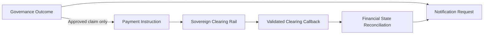

# Step 4.4: Outbound Confirmation & Financial Callback Verification

> Sequence authority: [roadmap.md](../roadmap.md).

## 1. Scope

This phase verifies two integrations: the governance outcome is handed to outbound delivery, and asynchronous payment callbacks reconcile approved claims. Channel-specific rendering is defined in [Step 3.5: Adaptive Multichannel Confirmation Delivery](./step3.5_adaptive_multichannel_confirmation_delivery.md). Claim and financial lifecycle rules are defined in [Step 2.3](./step2.3_governance_flows_and_state_transitions.md); they are not redefined here.

## 2. Financial Callback Contract

Only an approved claim with a valid internal transaction identifier may enter payment dispatch. A callback must be correlated to that instruction and validated before changing the financial state.

| Callback result | Required reference | Reconciliation result |
| :--- | :--- | :--- |
| **Successful settlement** | Clearing-house transaction reference or UTR | Record `SUCCESS`; reject a contradictory failure reason. |
| **Failed settlement** | Rejection reference and failure reason code | Record `FAILED`; retain the failure details for remediation. |
| **Returned settlement** | Return reference and applicable reason | Record `RETURNED`; do not move the transaction back to an earlier state. |

Financial states move forward only. Duplicate or stale callbacks must not cause repeated disbursement, reverse a terminal state, or create a second claim outcome.

## 3. Notification Handoff

Verify that each terminal governance result creates the appropriate outbound notification request and that a reconciled payment result can trigger a follow-up status notification. Channel selection, localized formatting, transport constraints, and carrier receipt handling are specified in [Step 3.5](./step3.5_adaptive_multichannel_confirmation_delivery.md).

## 4. Verification Matrix

| Scenario | Required result |
| :--- | :--- |
| Approved claim payment dispatch (idempotency) | Exactly one payment instruction is emitted and correlated with the internal transaction identifier; retries do not cause duplicate disbursements. |
| Successful callback with valid reference | State advances to `SUCCESS`; a status notification may be requested. |
| Failed or returned callback with required details | State advances to the matching terminal result and retains its reference and reason. |
| Missing, malformed, mismatched, duplicate, or stale callback | Reject or safely ignore according to the callback contract; do not mutate the ledger incorrectly. |
| Non-approved claim | No payment instruction is emitted. |
| Outbound notification handoff | Request is routed through the channel and rendering policy defined in [Step 3.5](./step3.5_adaptive_multichannel_confirmation_delivery.md). |

## 5. Acceptance Criteria

Payment callbacks are validated, correlated, and applied monotonically; notification requests reflect the reconciled outcome; and no non-approved claim triggers a payment instruction.
