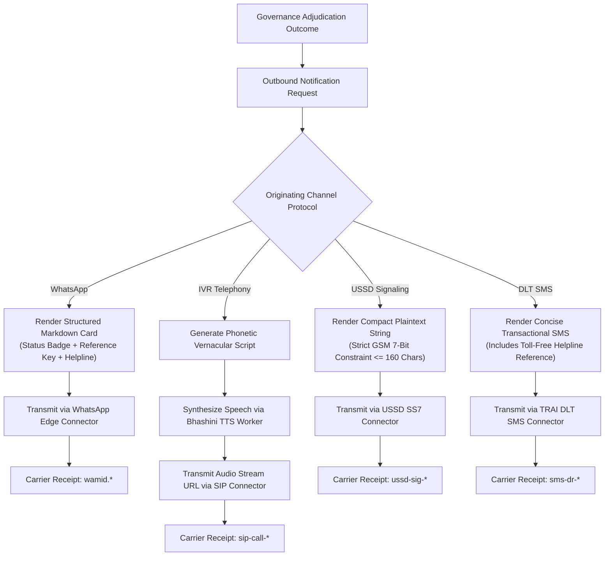
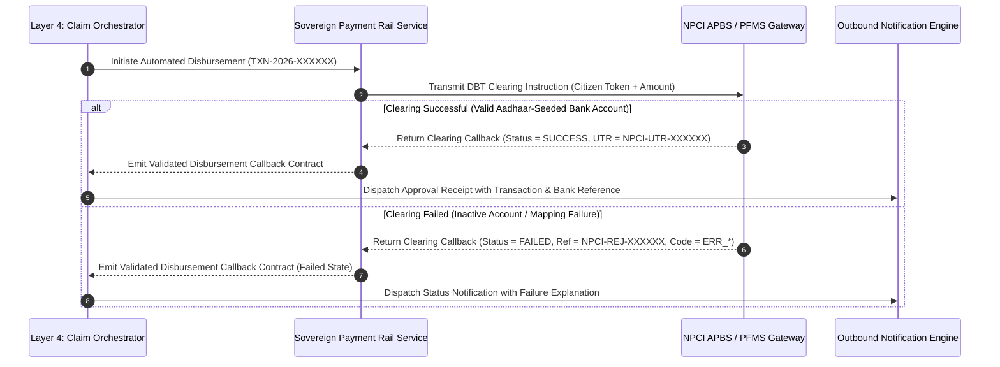

# Step 4.4: Outbound Confirmation & Financial Callback Verification Architecture

## 1. Executive Summary & Architectural Scope

This document defines the architectural specifications, adaptive formatting rules, and verification invariants for **Phase 4, Step 4.4: Outbound Confirmation & Financial Callback Verification** within the AgriStack Zero-Trust Digital Public Infrastructure (DPI) Orchestrator.

The final stage of citizen claim processing requires closing two critical operational loops:
1. **Adaptive Multi-Channel Confirmation Delivery:** Translating internal adjudication verdicts into channel-native citizen receipts—delivering rich markdown cards on WhatsApp, synthesized vernacular speech streams on IVR telephony, compact GSM 7-bit messages on USSD, and TRAI DLT-compliant notices on SMS.
2. **Sovereign Financial Clearing & Callback Reconciliation:** Interfacing with national Direct Benefit Transfer (DBT) payment rails (NPCI Aadhaar Payment Bridge System / PFMS Treasury Gateway) to initiate automated disbursements and reconcile asynchronous clearing callbacks under a monotonic forward-only state machine.

```
                ┌───────────────────────────────────────────────────────┐
                │          GOVERNANCE ADJUDICATION OUTCOME              │
                │    (AUTO_APPROVE / ROUTE_FOR_MANUAL_REVIEW / REJECT)  │
                └──────────────┬─────────────────────────┬──────────────┘
                               │                         │
            [If AUTO_APPROVE]  │                         │  [All Outcomes]
                               ▼                         ▼
  ┌────────────────────────────────────────┐ ┌────────────────────────────────────────┐
  │     SOVEREIGN PAYMENT CLEARING RAILS   │ │    ADAPTIVE NOTIFICATION ENGINE        │
  │  - Dispatches DBT Payment Instruction  │ │  - WhatsApp ──> Markdown Template Card │
  │  - Receives Clearing Status Callback   │ │  - IVR      ──> Bhashini TTS Audio URL │
  │    ├─ SUCCESS (NPCI-UTR-XXXXXX)        │ │  - USSD     ──> GSM 7-Bit (<=160 char) │
  │    └─ FAILED  (NPCI-REJ-XXXXXX + Code) │ │  - SMS      ──> TRAI DLT Plaintext     │
  └────────────────────────────────────────┘ └───────────────────┬────────────────────┘
                                                                 │
                                                                 ▼
                                             [ Carrier Transmission Acknowledgment ]
```

---

## 2. Adaptive Multi-Channel Notification Delivery

To ensure universal accessibility across rural India, the *Adaptive Multi-Channel Notification Engine* dynamically adapts adjudication outcomes to the originating communication protocol:



### 2.1 Channel Adaptation Specifications

| Channel Protocol | Rendering Format | Protocol Constraints & Invariants | Authoritative Receipt Prefix |
| :--- | :--- | :--- | :--- |
| **WhatsApp** | Rich Markdown Card | Includes visual status badges, bold scheme titles, transaction/case IDs, and toll-free helpline footer | `wamid.` |
| **IVR Telephony** | Spoken Audio Stream | Converts verdict into conversational Hindi/regional speech script and invokes Speech Synthesis (Bhashini TTS) to generate a pre-signed audio playback URL | `sip-call-` |
| **USSD Menu** | GSM 7-Bit Plaintext | Strictly bounded to $\le 160$ characters to fit within a single SS7/SIGTRAN signaling frame without truncation | `ussd-sig-` |
| **Transactional SMS** | Plaintext DLT Notice | Concise status summary ($\le 160$ characters) compliant with TRAI DLT transactional templates | `sms-dr-` |

---

## 3. Sovereign Payment Clearing & Financial Callbacks

When a citizen claim achieves straight-through automated approval (`AUTO_APPROVE`), the orchestration brain dispatches a disbursement instruction to sovereign payment clearing rails (NPCI APBS / PFMS Treasury Gateway) and reconciles the resulting clearing callback:



### 3.1 Monotonic Forward-Only State Machine Invariant
Financial clearing states strictly obey a monotonic forward-only progression:
* `PENDING` $\rightarrow$ `INITIATED` $\rightarrow$ `SUCCESS` / `FAILED` / `RETURNED`.
* Backward transitions (e.g., reverting a `SUCCESS` or `FAILED` transaction back to `PENDING`) are structurally forbidden to prevent duplicate disbursements or ledger desynchronization.

### 3.2 Clearing Callback Reconciliation Rules
1. **Successful Settlement (`SUCCESS`):**
   * Requires an authoritative Unique Transaction Reference (`NPCI-UTR-*`) generated by the clearing house.
   * Forbids failure reason codes (`failure_reason_code` must be `None`).
2. **Failed Settlement (`FAILED` / `RETURNED`):**
   * Requires an explicit rejection reference (`NPCI-REJ-*`) and a statutory failure code (e.g., `ERR_INSUFFICIENT_BANK_ACCOUNT_MAPPING`, `ERR_ACCOUNT_FROZEN_OR_DORMANT`).
   * Triggers automated audit logging and caseworker notification for citizen bank account remediation.

---

## 4. Verification & Simulation Matrix

The automated integration test suite validates both outbound delivery across all four channels and financial callback reconciliation:

1. **Multi-Channel Outbound Delivery Verification:**
   * Verifies WhatsApp markdown card generation and `wamid.` carrier receipt acknowledgment.
   * Verifies IVR voice speech synthesis (Bhashini TTS), pre-signed audio playback URL population, and `sip-call-` receipt acknowledgment.
   * Verifies USSD strict 160-character ceiling compliance across all governance actions and `ussd-sig-` receipt acknowledgment.
   * Verifies SMS transactional formatting, toll-free helpline inclusion, and `sms-dr-` receipt acknowledgment.
2. **Financial Clearing Callback Verification:**
   * Verifies straight-through `AUTO_APPROVE` claims initiate payment clearing and receive a `DisbursementStatus.SUCCESS` callback with a valid `NPCI-UTR-*` reference.
   * Verifies simulated bank clearing failures (`MOCK_PAYMENT_FAIL_TRIGGER`) produce a `DisbursementStatus.FAILED` callback with `NPCI-REJ-*` reference and statutory failure reason code (`ERR_INSUFFICIENT_BANK_ACCOUNT_MAPPING`).

---

## 5. Architectural Consequences

### Positive Consequences
* **Channel-Native Ergonomics:** Farmers receive confirmations formatted specifically for their device capabilities—audio playback for illiterate voice callers, compact 160-char frames for 2G feature phones, and rich cards for smartphone users.
* **End-to-End Financial Traceability:** Every approved claim links its internal session identifier (`session_id`) to both a carrier transmission acknowledgment (`carrier_reference_id`) and a sovereign banking clearing reference (`bank_reference_id`).
