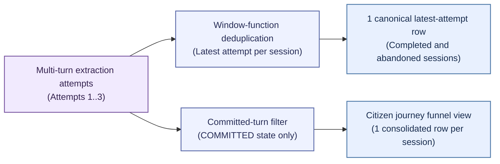
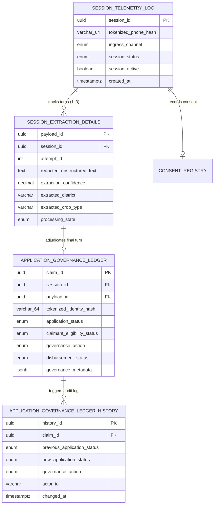

# Step 4.5: Database Persistence & Analytical Deduplication Verification

> Sequence authority: [roadmap.md](../roadmap.md).

## 1. Scope

This phase verifies relational schema conformance, multi-turn analytical deduplication, terminal metadata constraint enforcement, and append-only audit history population. The conceptual entity model is defined in [Step 0.2](./step0.2_data_model_design.md), zero-PII tokenization rules are defined in [Step 0.3](./step0.3_zero_trust_tokenization.md) and verified in [Step 4.2](./step4.2_security_firewall_and_zero_trust_pii_auditing.md), claim and financial lifecycle transitions are defined in [Step 2.3](./step2.3_governance_flows_and_state_transitions.md), and the authoritative table schemas, check constraints, triggers, indexes, and analytical views are defined in [Step 0.4](./step0.4_database_schema_design.md); they are not redefined here.

---

### 2. Relational Schema & Zero-PII Invariants

### 2.1 Zero-PII Storage Invariant
In strict compliance with sovereign data protection mandates, no table in the database stores cleartext citizen phone numbers, Aadhaar numbers, or unredacted personal identifiers:
* All phone numbers are persisted exclusively as 64-character hexadecimal SHA-256 HMAC digests (`tokenized_phone_hash`).
* All citizen identity references are persisted exclusively as 64-character hexadecimal SHA-256 HMAC digests (`tokenized_identity_hash`).
* Free-text transcripts stored in `redacted_unstructured_text` are pre-sanitized by the Layer 2 PII Purge Sentinel (`[REDACTED]`) prior to database insertion.

### 2.2 Entity-Relationship Architecture

---

## 3. Multi-Turn Conversational State Transitions & Deduplication

### 3.1 State Transitions
When a citizen requires multiple conversational turns to complete an agricultural subsidy claim, the database records each turn while transitioning prior incomplete turns to `SUPERSEDED`:

### 3.2 States deduplication
While [Step 0.4](./step0.4_database_schema_design.md) defines the committed-extraction staging view and the session-journey funnel view, this phase verifies that multi-attempt conversational logs do not produce cartesian fan-out under two distinct analytical query patterns:

| Analytical query pattern | Completed 3-turn session (`SUPERSEDED` $\rightarrow$ `SUPERSEDED` $\rightarrow$ `COMMITTED`) | Abandoned 2-turn session (`SUPERSEDED` $\rightarrow$ `STAGED`) | Verified invariant |
| :--- | :--- | :--- | :--- |
| **Window-function deduplication** (`ROW_NUMBER() OVER (PARTITION BY session_id ORDER BY attempt_id DESC) = 1`) | Returns attempt `3` (`COMMITTED`) with the final extracted district and crop entities. | Returns attempt `2` (`STAGED`) capturing the latest conversational state before drop-off. | Strictly 1 row per session across both completed and abandoned dialogues. |
| **Citizen journey funnel view** (`citizen_journey_funnel`) | Left-joins the single `COMMITTED` attempt (`3`) and unpacks the associated governance outcome (`approval_amount` / `rejection_reason`). | Preserves the parent session telemetry row with `NULL` committed-extraction and governance columns because no turn reached `COMMITTED`. | Strictly 1 row per session with zero duplicate claim or subsidy counting. |

## 4. Database Safety Nets & Immutable Audit Triggers

### 4.1 JSONB Structural Constraints
The `application_governance_ledger` table enforces database-level check constraints on semi-structured `governance_metadata`:
* **Approval Amount Invariant (`chk_approval_requires_amount`):** Any row with an approval governance action (`AUTO_APPROVE`, `AUTOMATED_PAYOUT`, `MANUAL_APPROVE`) must contain a numeric `approval_amount` key in `governance_metadata`.
* **Rejection Reason Invariant (`chk_rejection_requires_reason`):** Any row with a rejection governance action (`AUTO_REJECT`, `MANUAL_REJECT`) must contain a string `rejection_reason` key in `governance_metadata`.

### 4.2 Immutable History Triggers
Database triggers (`trg_audit_governance_ledger_insert` and `trg_audit_governance_ledger_update`) automatically append a record to `application_governance_ledger_history` whenever a claim is inserted or its status/action changes. This guarantees an immutable, tamper-evident audit trail for Comptroller and Auditor General (CAG) statutory inspections.

---
## 5. Verification Matrix

| Verification dimension | Test scenario | Required result |
| :--- | :--- | :--- |
| **Physical DDL conformance** | Inspect the physical DDL schema against [Step 0.4](./step0.4_database_schema_design.md) | All five tables, four analytical views, audit triggers, deduplication indexes, and 64-character token columns are present. |
| **Window-function deduplication** | Query a 5-row extraction log spanning a completed 3-turn session and an abandoned 2-turn session using `ROW_NUMBER() OVER (PARTITION BY session_id ORDER BY attempt_id DESC) = 1` | Returns exactly 2 rows: attempt `3` (`COMMITTED`) for the completed session and attempt `2` (`STAGED`) for the abandoned session. |
| **Funnel view zero fan-out** | Query `citizen_journey_funnel` across the same completed and abandoned multi-turn sessions | Returns exactly 2 rows: the completed session with unpacked governance metadata and the abandoned session with `NULL` committed-extraction and claim attributes. |
| **Terminal metadata constraints** | Insert an approved claim missing `approval_amount` or a rejected claim missing `rejection_reason` | Both inserts fail the database check constraints defined in [Step 0.4](./step0.4_database_schema_design.md). |
| **Append-only audit history triggers** | Insert an initial claim (`UNDER_REVIEW`) and subsequently update it to `APPROVED` (`MANUAL_APPROVE`) | Database triggers automatically record 2 chronological history rows capturing the prior status (`NULL`, then `UNDER_REVIEW`), new status, governance action, and actor identifier. |

## 6. Architectural Consequences

### Positive Consequences
* **Zero Fan-Out Guarantees:** Analytical views and window-function deduplication queries mathematically prevent duplicate claim counting across multi-attempt conversational loops.
* **Defense-in-Depth Data Integrity:** Database check constraints independently enforce business invariants (mandatory approval amounts and rejection reasons) even if application-layer validation is bypassed.
* **Full Regulatory Traceability:** Every automated or manual adjudication decision is permanently recorded in the immutable history table with actor attribution and timestamps.
