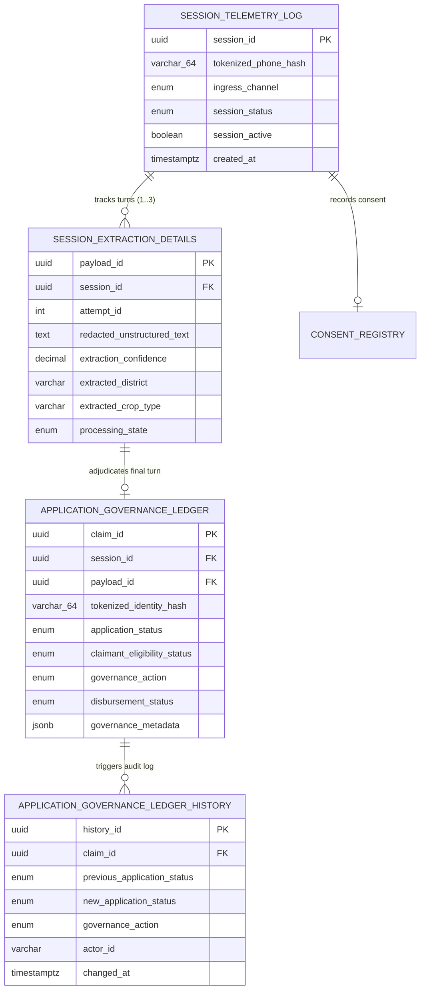
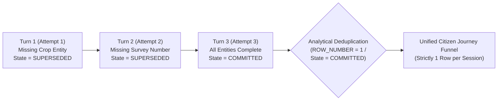

# Step 4.5: Database Persistence & Analytical Deduplication Architecture

> Sequence authority: [roadmap.md](../roadmap.md).

## 1. Executive Summary & Data Governance Scope

This document defines the relational persistence architecture, immutable audit triggers, and analytical deduplication specifications for **Phase 4, Step 4.5: Database Persistence & Analytical Deduplication** within the AgriStack Zero-Trust Digital Public Infrastructure (DPI) Orchestrator.

When citizens interact with the public welfare orchestrator over multi-turn voice or messaging sessions, each conversational turn generates an extraction record (`attempt_id = 1, 2, 3`). Without rigorous relational state management and analytical deduplication, downstream Business Intelligence (BI) dashboards and treasury reconciliation reports suffer from **cartesian fan-out**—inflating claim counts and double-counting subsidy liabilities.

The relational persistence layer solves this through a three-tier data architecture:
1. **Normalized Transactional Core:** Separation of session telemetry (`session_telemetry_log`), multi-attempt perception logs (`session_extraction_details`), and authoritative adjudication decisions (`application_governance_ledger`).
2. **Immutable Audit Ledger:** Database-level triggers automatically capturing every state transition (`application_governance_ledger_history`) with zero application-side bypass risk.
3. **Analytical Deduplication & One-Big-Table (OBT) Marts:** Window-function deduplication (`ROW_NUMBER() OVER (PARTITION BY session_id ORDER BY attempt_id DESC)`) paired with state filtering (`processing_state = 'COMMITTED'`) to guarantee strictly one canonical row per citizen session in analytical views (`citizen_journey_funnel`).

```
  ┌──────────────────────────────────────────────────────────────────────────────────┐
  │                       TRANSACTIONAL PERSISTENCE LAYER                            │
  │                                                                                  │
  │  [session_telemetry_log] (1) ──────< (N) [session_extraction_details]            │
  │    - session_id (PK)                       - payload_id (PK)                     │
  │    - tokenized_phone_hash (64-char HMAC)   - attempt_id (1, 2, 3)                │
  │                                            - processing_state (SUPERSEDED/COMMIT)│
  │                                                      │                           │
  │                                                      ▼ (1:1 Authoritative Turn)  │
  │  [consent_registry]                      [application_governance_ledger]         │
  │    - consent_id (PK)                       - claim_id (PK)                       │
  │    - tokenized_identity_hash               - governance_action (APPROVE/REJECT)  │
  │    - provenance (JSONB Audit)              - disbursement_status (PENDING/...)   │
  └──────────────────────────────────────────────────────┬───────────────────────────┘
                                                         │
                                    [Database Triggers]  │  [Analytical Views]
                                                         ▼
  ┌──────────────────────────────────────────────────────────────────────────────────┐
  │                  AUDIT & ANALYTICAL DEDUPLICATION LAYER                          │
  │                                                                                  │
  │  1. Immutable History Ledger (application_governance_ledger_history)             │
  │  2. Committed Turn Filter (staging_committed_extractions)                        │
  │  3. Window-Function Deduplication (ROW_NUMBER() OVER PARTITION BY session_id)    │
  │  4. Unified Citizen Journey Funnel View (citizen_journey_funnel OBT)             │
  └──────────────────────────────────────────────────────────────────────────────────┘
```

---

## 2. Relational Schema & Zero-PII Invariants

### 2.1 Zero-PII Storage Invariant
In strict compliance with sovereign data protection mandates, no table in the database stores cleartext citizen phone numbers, Aadhaar numbers, or unredacted personal identifiers:
* All phone numbers are persisted exclusively as 64-character hexadecimal SHA-256 HMAC digests (`tokenized_phone_hash`).
* All citizen identity references are persisted exclusively as 64-character hexadecimal SHA-256 HMAC digests (`tokenized_identity_hash`).
* Free-text transcripts stored in `redacted_unstructured_text` are pre-sanitized by the Layer 2 PII Purge Sentinel (`[REDACTED]`) prior to database insertion.

### 2.2 Entity-Relationship Architecture



---

## 3. Multi-Turn Conversational State Transitions & Deduplication

When a citizen requires multiple conversational turns to complete an agricultural subsidy claim, the database records each turn while transitioning prior incomplete turns to `SUPERSEDED`:



### 3.1 Analytical Deduplication Strategies
To eliminate fan-out during analytical queries, the persistence layer supports two complementary deduplication patterns:
1. **State-Driven Deduplication (`staging_committed_extractions`):**
   * Filters `session_extraction_details` where `processing_state = 'COMMITTED'`.
   * Guarantees that intermediate `STAGED` or `SUPERSEDED` turns are excluded from downstream joins.
2. **Window-Function Analytical Deduplication (`ROW_NUMBER() OVER (...)`):**
   * Partitions extraction records by `session_id` ordered by `attempt_id DESC` (and `created_at DESC`).
   * Selects strictly rank `1` (`ROW_NUMBER() OVER (PARTITION BY session_id ORDER BY attempt_id DESC) = 1`), ensuring that even if a session was abandoned mid-dialogue before reaching `COMMITTED`, analytical queries retrieve the latest conversational state without duplicate rows.

---

## 4. Database Safety Nets & Immutable Audit Triggers

### 4.1 JSONB Structural Constraints
The `application_governance_ledger` table enforces database-level check constraints on semi-structured `governance_metadata`:
* **Approval Amount Invariant (`chk_approval_requires_amount`):** Any row with an approval governance action (`AUTO_APPROVE`, `AUTOMATED_PAYOUT`, `MANUAL_APPROVE`) must contain a numeric `approval_amount` key in `governance_metadata`.
* **Rejection Reason Invariant (`chk_rejection_requires_reason`):** Any row with a rejection governance action (`AUTO_REJECT`, `MANUAL_REJECT`) must contain a string `rejection_reason` key in `governance_metadata`.

### 4.2 Immutable History Triggers
Database triggers (`trg_audit_governance_ledger_insert` and `trg_audit_governance_ledger_update`) automatically append a record to `application_governance_ledger_history` whenever a claim is inserted or its status/action changes. This guarantees an immutable, tamper-evident audit trail for Comptroller and Auditor General (CAG) statutory inspections.

---

## 5. Verification & Analytical Simulation Matrix

The automated integration test suite verifies schema integrity, constraint enforcement, and analytical deduplication:

| Verification Dimension | Tested Scenario | Expected Relational / Analytical Outcome | Audited Invariant |
| :--- | :--- | :--- | :--- |
| **Schema DDL Conformance** | Structural inspection of `schema.sql` | Verifies all 5 tables, 4 analytical views, triggers, indexes, and zero-PII 64-char HMAC columns | 100% DDL contract compliance |
| **Multi-Turn Deduplication** | 3-attempt session (`attempt_id = 1, 2, 3`) | Window function (`ROW_NUMBER() OVER PARTITION BY session_id`) and `COMMITTED` view return strictly 1 row (`attempt_id = 3`) | Zero cartesian fan-out in BI queries |
| **OBT Funnel Join** | Joining telemetry, extractions, and governance ledger | `citizen_journey_funnel` returns 1 consolidated row per session with unpacked JSON metadata | Accurate end-to-end funnel metrics |
| **Terminal Constraints** | Approval without `approval_amount` or Rejection without `rejection_reason` | Database constraint check rejects invalid terminal state rows | Zero malformed financial verdicts |

---

## 6. Architectural Consequences

### Positive Consequences
* **Zero Fan-Out Guarantees:** Analytical views and window-function deduplication queries mathematically prevent duplicate claim counting across multi-attempt conversational loops.
* **Defense-in-Depth Data Integrity:** Database check constraints independently enforce business invariants (mandatory approval amounts and rejection reasons) even if application-layer validation is bypassed.
* **Full Regulatory Traceability:** Every automated or manual adjudication decision is permanently recorded in the immutable history table with actor attribution and timestamps.
