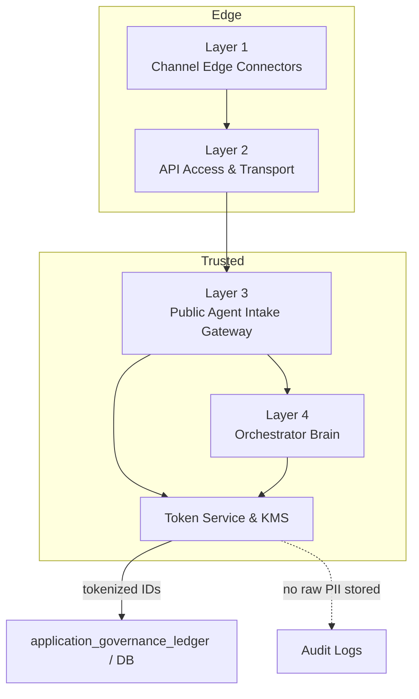

# Zero-Trust Purge & Tokenization Protocols

**Framework Step:** Phase 0 · Step 0.3: Establish Zero-Trust Purge & Tokenization Protocols  
**Related Documents:** 
- [roadmap.md](../roadmap.md)
- [flowchart.md](../design-specs/step3-guardrails/flowchart.md)
- [data_model_design.md](./data_model_design.md)

---

## 1. Goal

Establish the strict zero-trust data privacy boundaries required for citizen PII. Specifically, identify the ingress points of cleartext PII (such as Aadhaar numbers or ANI phone numbers), define the in-memory tokenization protocol, and set non-negotiable architectural mandates to ensure cleartext PII never touches persistent disk storage.

---

## 2. PII Ingress Identification

Based on our multi-channel architecture, cleartext Personally Identifiable Information (PII) enters the system at specific ingress points (Layer 1 -> Layer 2 -> Layer 3):

1. **Source Phone Number (ANI):** Reaches the system through channel connectors (WhatsApp webhook, IVR SIP gateway, USSD signaling). This is required initially for session tracking but poses a privacy risk if stored long-term in cleartext.
2. **Citizen Identity Numbers (Aadhaar / Farmer ID):** Captured explicitly as part of the conversational AI extraction or USSD input to perform `identity_verify()` against DPI registries (e.g., MOSIP / Aadhaar). 
3. **Location / Cadastral Data:** Geographic coordinates, property parcel identifiers, or farm boundary data may appear less sensitive in isolation, but once linked to a specific identity token they can be used to infer a person’s exact residence, land ownership, and movements. In that combined form, the data is treated as protected because it materially increases re-identification risk and privacy impact.
> [!WARNING] **Cleartext Ban**  
> Under no circumstances will cleartext Aadhaar numbers or other highly sensitive citizen ID numbers be written to the database or written to disk-based application logs.

---

## 3. In-Memory Tokenization Protocol

To interact with downstream systems and maintain transactional consistency without violating privacy mandates, we will apply a one-way hashing protocol in volatile RAM.

### 3.1. Hashing Algorithm
All highly sensitive identifiers (e.g., Aadhaar) must be hashed immediately upon extraction. We have objectively evaluated several alternatives and selected **HMAC-SHA256**; see [hashing_algorithm_evaluation.md](./hashing_algorithm_evaluation.md) for the complete rationale.
- **Function:** `HMAC-SHA256`
- **Key Strategy:** Use a secure, environment-injected cryptographic pepper/salt (`pepper_salt`) that is never stored in the database but rather managed via environment variables/secrets manager.
- **Implementation (Concept):**
  ```javascript
  const crypto = require('crypto');
  
  function tokenizePII(rawId, pepperSalt) {
      return crypto.createHmac('sha256', pepperSalt)
                   .update(rawId)
                   .digest('hex');
  }
  ```

### 3.2 Execution Boundary & Rationale
Tokenization must occur inside the trusted intake/orchestrator boundary (Layer 3 or immediately after entity extraction in Layer 4) and always before any payload is marshaled for database persistence or passed to the `application_governance_ledger`.

- **Trust boundary & KMS placement:** Edge connectors and transport proxies lack hardened key management and secure token services; cryptographic keys and token registries must remain inside the trusted intake/orchestrator environment.
- **Insufficient context for correct tokenization:** Accurate tokenization requires entity typing and schema context (is this an ID, phone, or free text). That context is produced during normalization and SLM extraction in L3/L4.
- **Expanded attack surface & exposure:** Tokenizing at the edge forces many more components to handle raw PII (logs, caches, brokers), increasing storage and exfiltration risk.
- **Policy and consent coupling:** Consent checks, retention policies, and governance rules live in L3/L4 — tokenization must be co-located so it can honor consent before persistence or ledgering.
- **Auditability & provenance:** The `application_governance_ledger` should record token identifiers and policy metadata; tokenizing before DB/ledger writes ensures persisted records never contain raw values.
- **Consistency & lifecycle operations:** Central token registries simplify rotation, revocation, and mapping consistency; distributing token logic across edge nodes leads to sync and revocation complexity.
- **Operational reliability & simplicity:** Centralized token services make telemetry, retries, and secure error handling easier; keep edge components minimal and latency-sensitive.



---

## 4. Memory Purge & Persistence Mandate

To guarantee compliance, the architecture must enforce explicit data purging rules:

1. **Volatile RAM Only:** Variables containing cleartext PII must exist strictly within the lifecycle of the active application process memory.
2. **Explicit Nullification:** Once tokenized and verified against the authoritative registry (via `identity_verify()`), the cleartext variable must be explicitly scoped to be cleaned up by the garbage collector immediately, and omitted from the DB model object.
3. **Database Schema Constraints:** In Step 0.4 (Schema DDL), columns designed to store identity must be explicitly named to denote hashed data (e.g., `tokenized_identity_hash` instead of `aadhaar_number`). Explicit, token-specific column names prevent mistakes, make intent and auditability obvious, and enable precise DB-level constraints, indexing, and access controls so cleartext PII is never accidentally stored or queried.

### 4.1. Update to the Relational Data Model

As noted in [data_model_design.md](./data_model_design.md), both the session log and governance ledger are updated to use tokenized hashes:

| Table | Attribute Name | Data Type | Description |
| :--- | :--- | :--- | :--- |
| `application_governance_ledger` | `tokenized_identity_hash` | `VARCHAR(64)` | SHA-256 hex digest of the citizen's Aadhaar/ID number. |
| `session_telemetry_log` | `tokenized_phone_hash` | `VARCHAR(64)` | SHA-256 hex digest of the citizen's phone number. |

> [!IMPORTANT]
> **Active Session Routing:** Since the persistent database only stores the `tokenized_phone_hash`, any active session routing (e.g., needing the cleartext phone number to send an asynchronous WhatsApp reply) must be handled by keeping the cleartext phone number in volatile RAM (or a volatile cache like Redis with a strict TTL) for the duration of the active session only. It must never be written to PostgreSQL.

---

## 5. Stateless Multi-Turn Interaction Flow (Zero-Trust)

A core challenge of zero-trust conversational agents is maintaining session continuity across multiple conversational turns (e.g., asking for crop, then district) without storing the citizen's cleartext phone number in the database between messages.

The Orchestrator resolves this by relying on the stateless nature of network protocols, where **the channel provider (WhatsApp, USSD) transmits the cleartext phone number on every single interaction webhook**.

**The Execution Flow:**
1. **Turn 1 (Initiation):** A webhook arrives (`From: +919876543210`, `Message: "Hi"`).
  - Layer(s): `Layer 1` (Channel Edge) receives the webhook; `Layer 2` (API Access) forwards to `Layer 3` (Public Agent Intake) and/or `Layer 4` (Orchestrator Brain).
  - The Orchestrator (Layer 4) receives the payload in volatile RAM.
  - The Orchestrator (Layer 4) hashes the phone number (`tokenizePII`) to generate `tokenized_phone_hash`.
  - The Orchestrator (Layer 4) creates a new record in `session_telemetry_log` using the hash (persistent write).
  - The Orchestrator (Layer 4) replies to the webhook; the outbound reply traverses `Layer 3 -> Layer 2 -> Layer 1` to the channel provider.
  - The HTTP request ends, and Layer 4 purges cleartext from RAM (garbage collection / explicit nullification).
2. **Turn N (Completion):** A new webhook arrives (`From: +919876543210`, `Message: "Karnal"`).
  - Layer(s): `Layer 1` (Channel Edge) receives the webhook; `Layer 2` forwards to `Layer 3/4`.
  - The Orchestrator (Layer 4) receives the cleartext phone number in volatile RAM *again*.
  - The Orchestrator (Layer 4) generates the `tokenized_phone_hash` to look up the active session in `session_telemetry_log` (DB read).
  - The Orchestrator (Layer 4) determines the claim data is now complete.
  - The Orchestrator (Layer 4) calls `submit_application()` to the external OpenSPP registry (External DPI Vault) over secure HTTPS, sending **cleartext phone number** but only in-transit.
  - OpenSPP (External DPI Vault) securely stores the PII and returns an `openspp_case_id`.
  - The Orchestrator (Layer 4) writes the `openspp_case_id` to the `application_governance_ledger` (persistent write) along with the token hashes and provenance metadata.
  - The HTTP request ends, Layer 4 purges cleartext from RAM, and the cleartext phone number is dropped.

**Future Follow-ups (Delegation to Secure Vault):**
If a human caseworker needs to contact the citizen, or an asynchronous payout receipt must be sent days later, the Orchestrator does *not* have the phone number. 
- Caseworkers will log directly into the OpenSPP secure dashboard to access the citizen's contact details.
- Automated system alerts will query OpenSPP using the `openspp_case_id` to retrieve a short-lived token or have OpenSPP dispatch the notification directly.

---

## 6. Summary Verification Against Roadmap Step 0.3

| Requirement in `roadmap.md` Step 0.3 | Execution in This Design | Verification Status |
| :--- | :--- | :--- |
| Analyze privacy mandates | Established strict ban on persistent cleartext PII storage. | ✅ Validated |
| Identify PII ingress points | Identified channels (ANI) and conversational extraction (Aadhaar). | ✅ Validated |
| Define in-memory tokenization | Established HMAC-SHA256 cryptographic protocol. | ✅ Validated |
| Establish memory purge rule | Mandated volatile RAM-only existence with explicit nullification before DB write. | ✅ Validated |

---
