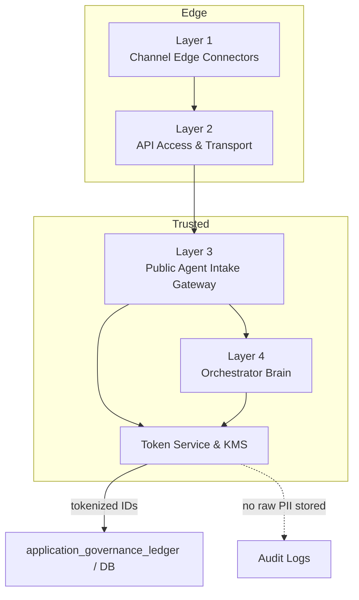

# Zero-Trust Purge & Tokenization Protocols

**Framework Step:** Phase 0 · Step 0.3: Establish Zero-Trust Purge & Tokenization Protocols  
**Related Documents:** 
- [roadmap.md](../roadmap.md)
- [flowchart.md](../design-specs/step3-guardrails/flowchart.md)
- [data_model_design.md](./data_model_design.md)

---

## 1. Goal

Establish the strict zero-trust data privacy boundaries required for citizen PII. Specifically, identify the ingress points of cleartext PII (such as Aadhaar numbers or ANI phone numbers), define the in-memory tokenization protocol, and set non-negotiable architectural mandates to ensure cleartext PII never touches persistent disk storage.

---

## 2. PII Ingress Identification

Based on our multi-channel architecture, cleartext Personally Identifiable Information (PII) enters the system at specific ingress points (Layer 1 -> Layer 2 -> Layer 3):

> **Note:** Layer 1 and Layer 2 must never write cleartext PII to persistent storage or disk logs; they may only forward cleartext in-memory to L3/L4. Edge layers may only use orchestrator-issued tokens or ephemeral, tightly TTL'd encrypted caches when absolutely necessary.

1. **Source Phone Number (ANI):** Reaches the system through channel connectors (WhatsApp webhook, IVR SIP gateway, USSD signaling). This is required initially for session tracking but poses a privacy risk if stored long-term in cleartext.
2. **Citizen Identity Numbers (Aadhaar / Farmer ID):** Captured explicitly as part of the conversational AI extraction or USSD input to perform `identity_verify()` against DPI registries (e.g., MOSIP / Aadhaar). 
3. **Location / Cadastral Data:** Geographic coordinates, property parcel identifiers, or farm boundary data may appear less sensitive in isolation, but once linked to a specific identity token they can be used to infer a person’s exact residence, land ownership, and movements. In that combined form, the data is treated as protected because it materially increases re-identification risk and privacy impact.
> [!WARNING] **Cleartext Ban**  
> Under no circumstances will cleartext Aadhaar numbers or other highly sensitive citizen ID numbers be written to the database or written to disk-based application logs.

---

## 3. In-Memory Tokenization Protocol

To interact with downstream systems and maintain transactional consistency without violating privacy mandates, we will apply a one-way hashing protocol in volatile RAM.

### 3.1. Hashing Algorithm
All highly sensitive identifiers (e.g., Aadhaar) must be hashed immediately upon extraction. We have objectively evaluated several alternatives and selected **HMAC-SHA256**; see [hashing_algorithm_evaluation.md](./hashing_algorithm_evaluation.md) for the complete rationale.
- **Function:** `HMAC-SHA256`
- **Key Strategy:** Use a secure, environment-injected cryptographic pepper/salt (`pepper_salt`) that is never stored in the database but rather managed via environment variables/secrets manager.
- **Implementation (Concept):**
  ```javascript
  const crypto = require('crypto');
  
  function tokenizePII(rawId, pepperSalt) {
      return crypto.createHmac('sha256', pepperSalt)
                   .update(rawId)
                   .digest('hex');
  }
  ```

### 3.2 Execution Boundary & Rationale
Tokenization must happen inside the trusted intake/orchestrator (Layer 3 or right after extraction in Layer 4) and always be done before anything is saved to the database or written to the `application_governance_ledger` This means Layer 1 and Layer 2 must never write cleartext PII to persistent storage or disk logs; they may only forward cleartext in-memory to L3/L4 or use orchestrator-issued tokens/ephemeral encrypted caches with strict TTLs.

- **Core rule:** Do the hashing/tokenization in the trusted orchestrator and never persist raw PII.
  - Example: A webhook with `From: +919876543210` is hashed by the orchestrator; only the hash is stored.

- **Keep keys inside the trusted zone:** Store cryptographic keys and token services in the orchestrator/KMS, not on edge connectors.
  - Example: KMS lives with the orchestrator; the WhatsApp edge never receives the key.

  - **Edge terminology:**
    - **Edge / Layer 1:** Channel-specific ingress points (WhatsApp webhook endpoints, IVR SIP gateways, USSD gateways) that receive messages from providers.
    - **Edge connector / Layer 2:** Protocol adapters and transport glue (API gateways, reverse proxies, message brokers) that normalize and forward payloads to the orchestrator.
    - **Edge service:** Any service running in L1/L2 that performs routing, rate-limiting, or format normalization but is not the trusted orchestrator (e.g., webhook handler, protocol translator).
    - **Guideline:** Treat edges as untrusted for key management — keep long-lived crypto keys and token registries in L3/L4 and have edges forward encrypted payloads or orchestrator-issued ephemeral tokens.

- **You need context to tokenize correctly:** Tokenization requires knowing the data type (phone, Aadhaar, free text), which is produced by L3/L4 processing.
  - Example: The orchestrator recognizes an Aadhaar number and applies the approved HMAC-SHA256 process.

  - **Why this matters**: tokenization must follow classification because different types need different handling — normalize formats, validate inputs, and separate domains so tokens can't be cross-matched. For example:
    - Normalize phone formats (`+91 98765 43210` -> `+919876543210`) so the same number always produces the same token.
    - Validate structure (Aadhaar is 12 digits) to avoid hashing invalid or malformed values.
    - Use type-specific keys or prefixes, so that a phone hash cannot equal an Aadhaar hash even if digits overlap.
    - Apply per-type policy/consent and lookup rules (phone routing vs identity verification require different treatments).

- **Avoid widening the attack surface:** If tokenization infrastructure (token services, KMS, caches, rotation logic) runs at the edge, you multiply the number of components responsible for managing secrets and token mappings. Each component becomes an attack vector.
  - **Example — Distributed token services:** Suppose you have 3 API gateways, each running its own token service with its own Redis cache and pepper stored in environment variables. An attacker who compromises one gateway gains access to that gateway's pepper, token cache (raw phone → token mappings), and tokenization logs (which record both the raw value and its token). To properly rotate keys, you must coordinate across all 3 gateways—sync delays cause token mismatches and force debug logging that may expose raw values. A single compromised container, exposed Redis instance, or accidentally committed `.env` file exposes the entire mapping.
  - **Contrast — Centralized token service:** If tokenization happens only in the orchestrator (Layer 4), there is one token service, one KMS, one cache, and one set of logs to secure. Edge gateways never handle secrets or token mappings; they only forward raw data in volatile RAM (which is garbage-collected after the request ends). An attacker who compromises a gateway has only transient in-memory data; they cannot forge tokens because the pepper and token logic are isolated in the orchestrator's secure network.

- **Respect policy and consent where it lives:** Consent, retention, and governance checks run in L3/L4, so tokenization should be colocated to enforce those rules before persistence.
  - Example: If consent is revoked, the orchestrator can stop storing or ledgering the token.

- **Make auditing simple:** Tokenize before writing to the ledger so stored records contain only token identifiers and policy metadata, not raw values.
  - Example: The ledger stores `tokenized_identity_hash` and `consent=true` instead of the actual Aadhaar number.

- **Simplify rotation and revocation:** A central token registry/service makes key rotation and revocation straightforward; distributing token logic causes sync problems.
  - Example: Rotate keys in a single token service rather than updating many edge nodes.

- **Keep edges simple and reliable:** Central token services make retries, monitoring, and secure error handling easier while allowing edge components to stay fast and minimal.
  - Example: The orchestrator handles token-service retries; the edge only forwards payloads.



---

## 4. Memory Purge & Persistence Mandate

To guarantee compliance, the architecture must enforce explicit data purging rules:

1. **Volatile RAM Only:** Variables containing cleartext PII must exist strictly within the lifecycle of the active application process memory.
2. **Explicit Nullification:** Once tokenized and verified against the authoritative registry (via `identity_verify()`), the cleartext variable must be explicitly scoped to be cleaned up by the garbage collector immediately, and omitted from the DB model object.
3. **Database Schema Constraints:** In Step 0.4 (Schema DDL), columns designed to store identity must be explicitly named to denote hashed data (e.g., `tokenized_identity_hash` instead of `aadhaar_number`). Explicit, token-specific column names prevent mistakes, make intent and auditability obvious, and enable precise DB-level constraints, indexing, and access controls so cleartext PII is never accidentally stored or queried.
4. **Edge persistence restriction:** Layer 1 and Layer 2 must not persist cleartext PII to durable storage or disk logs; any temporary caches used by edge components must be encrypted, tightly TTL'd, access-controlled, and audited. Prefer keeping cleartext only in application RAM and using orchestrator-issued ephemeral tokens instead.

---

## 5. Stateless Multi-Turn Interaction Flow (Zero-Trust)

A core challenge of zero-trust conversational agents is maintaining session continuity across multiple conversational turns (e.g., asking for crop, then district) without storing the citizen's cleartext phone number in the database between messages.

The Orchestrator resolves this by relying on the stateless nature of network protocols, where **the channel provider (WhatsApp, USSD) transmits the cleartext phone number on every single interaction webhook**.

**The Execution Flow:**
1. **Turn 1 (Initiation):** A webhook arrives (`From: +919876543210`, `Message: "Hi"`).
  - Layer(s): `Layer 1` (Channel Edge) receives the webhook; `Layer 2` (API Access) forwards to `Layer 3` (Public Agent Intake) and/or `Layer 4` (Orchestrator Brain).
  - The Orchestrator (Layer 4) receives the payload in volatile RAM.
  - The Orchestrator (Layer 4) hashes the phone number (`tokenizePII`) to generate `tokenized_phone_hash`.
  - The Orchestrator (Layer 4) creates a new record in `session_telemetry_log` using the hash (persistent write).
  - The Orchestrator (Layer 4) replies to the webhook; the outbound reply traverses `Layer 3 -> Layer 2 -> Layer 1` to the channel provider.
  - The HTTP request ends, and Layer 4 purges cleartext from RAM (garbage collection / explicit nullification).
2. **Turn N (Completion):** A new webhook arrives (`From: +919876543210`, `Message: "Karnal"`).
  - Layer(s): `Layer 1` (Channel Edge) receives the webhook; `Layer 2` forwards to `Layer 3/4`.
  - The Orchestrator (Layer 4) receives the cleartext phone number in volatile RAM *again*.
  - The Orchestrator (Layer 4) generates the `tokenized_phone_hash` to look up the active session in `session_telemetry_log` (DB read).
  - The Orchestrator (Layer 4) determines the claim data is now complete.
  - The Orchestrator (Layer 4) calls `submit_application()` to the external OpenSPP registry (External DPI Vault) over secure HTTPS, sending **cleartext phone number** but only in-transit.
  - OpenSPP (External DPI Vault) securely stores the PII and returns an `openspp_case_id`.
  - The Orchestrator (Layer 4) writes the `openspp_case_id` to the `application_governance_ledger` (persistent write) along with the token hashes and provenance metadata.
  - The HTTP request ends, Layer 4 purges cleartext from RAM, and the cleartext phone number is dropped.

**Future Follow-ups (Delegation to Secure Vault):**
If a human caseworker needs to contact the citizen, or an asynchronous payout receipt must be sent days later, the Orchestrator does *not* have the phone number. 
- Caseworkers will log directly into the OpenSPP secure dashboard to access the citizen's contact details.
- Automated system alerts will query OpenSPP using the `openspp_case_id` to retrieve a short-lived token or have OpenSPP dispatch the notification directly.

---

## 6. Summary Verification Against Roadmap Step 0.3

| Requirement in `roadmap.md` Step 0.3 | Execution in This Design | Verification Status |
| :--- | :--- | :--- |
| Analyze privacy mandates | Established strict ban on persistent cleartext PII storage. | ✅ Validated |
| Identify PII ingress points | Identified channels (ANI) and conversational extraction (Aadhaar). | ✅ Validated |
| Define in-memory tokenization | Established HMAC-SHA256 cryptographic protocol. | ✅ Validated |
| Establish memory purge rule | Mandated volatile RAM-only existence with explicit nullification before DB write. | ✅ Validated |

---
