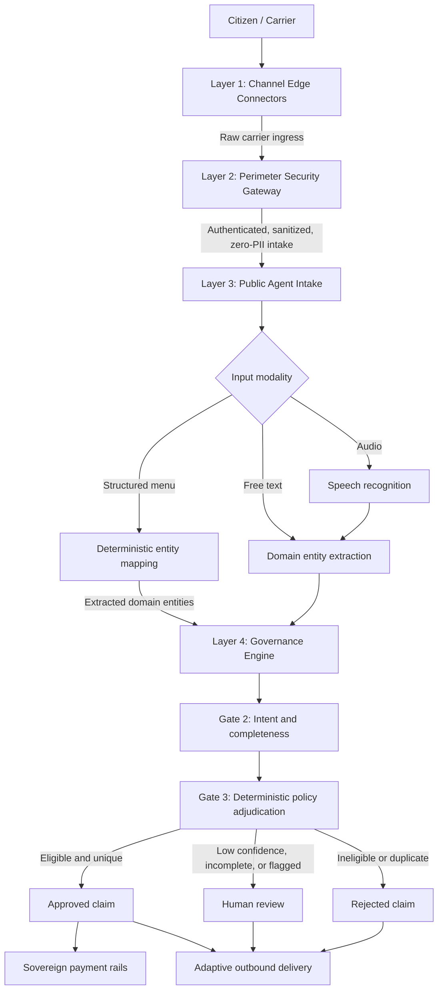

# Master Architecture Flow

This diagram summarizes the system boundaries. Detailed security and governance decisions are maintained in their respective architecture records.

The decision threshold, state transitions, security response, channel formats, and persistence rules are specified in the linked decision records rather than duplicated in this overview.
