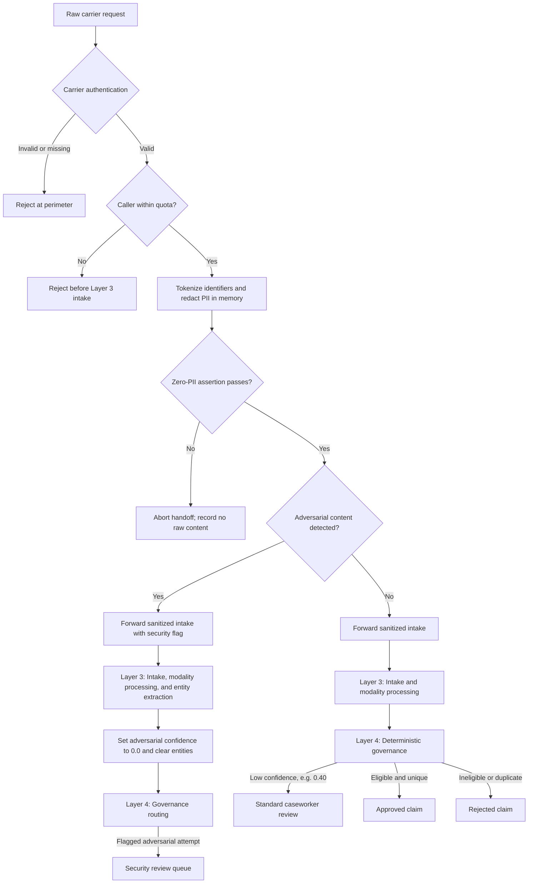

# Security Guardrail Flow

This diagram supplements the [master architecture flow](./flowchart.md) with the security branches that gate ingress and govern adversarial routing. The zero-trust PII policy is established in the foundational tokenization decision.

An adversarial confidence score of `0.0` is reserved for security neutralization. Benign low-confidence inputs, including unparseable audio, follow the ordinary review path and must not be mislabeled as security threats. Only sanitized content and pseudonymous identifiers may be persisted.
