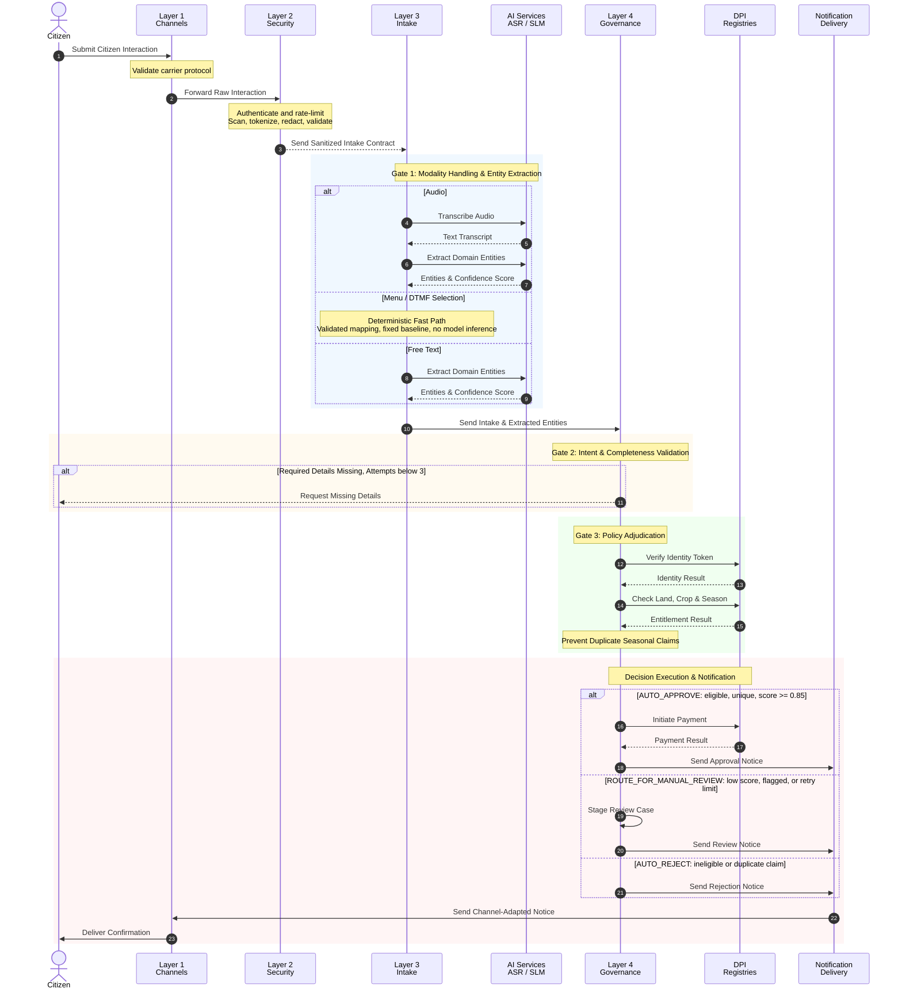
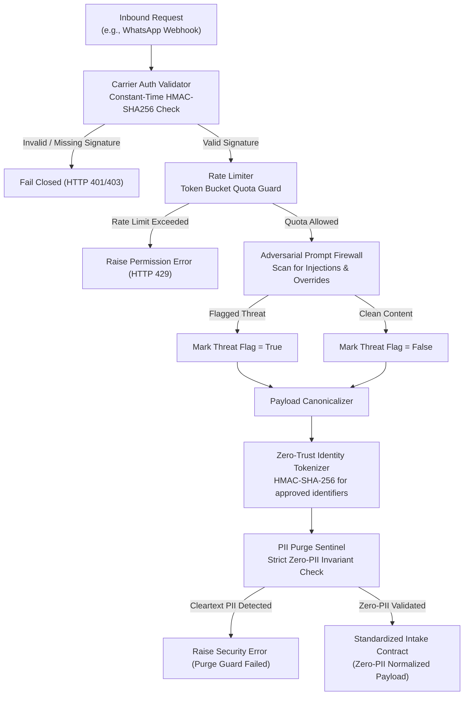
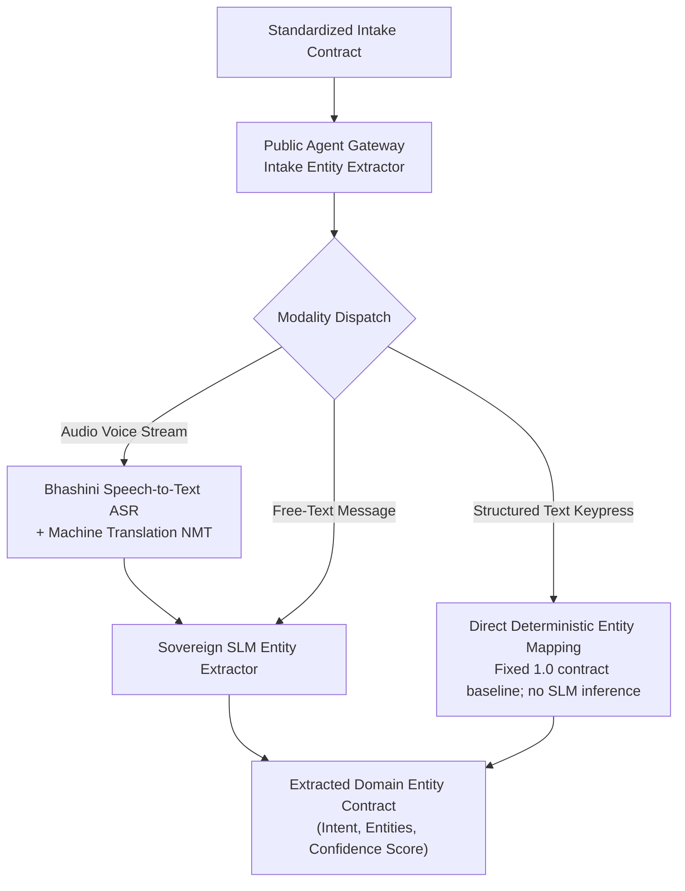
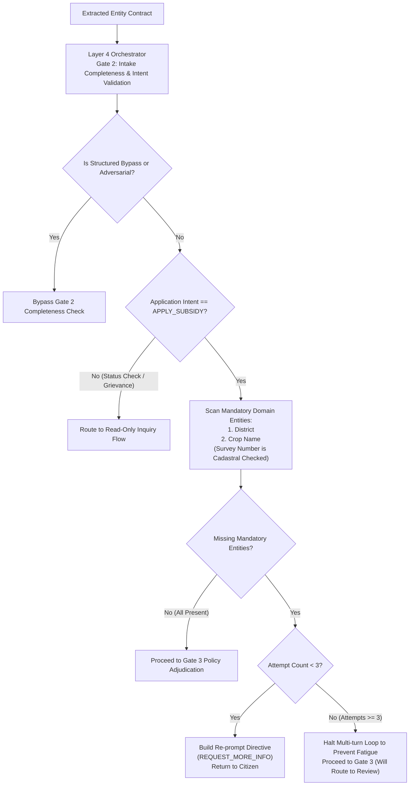
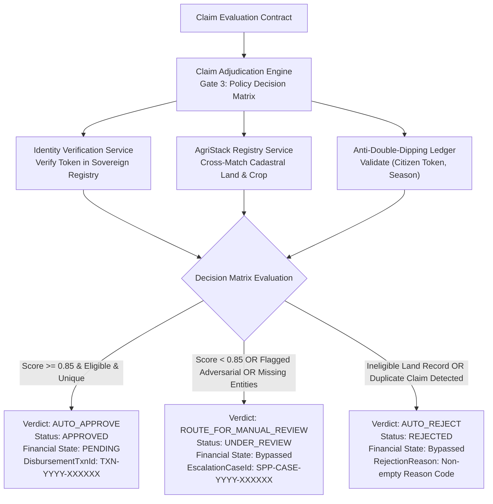
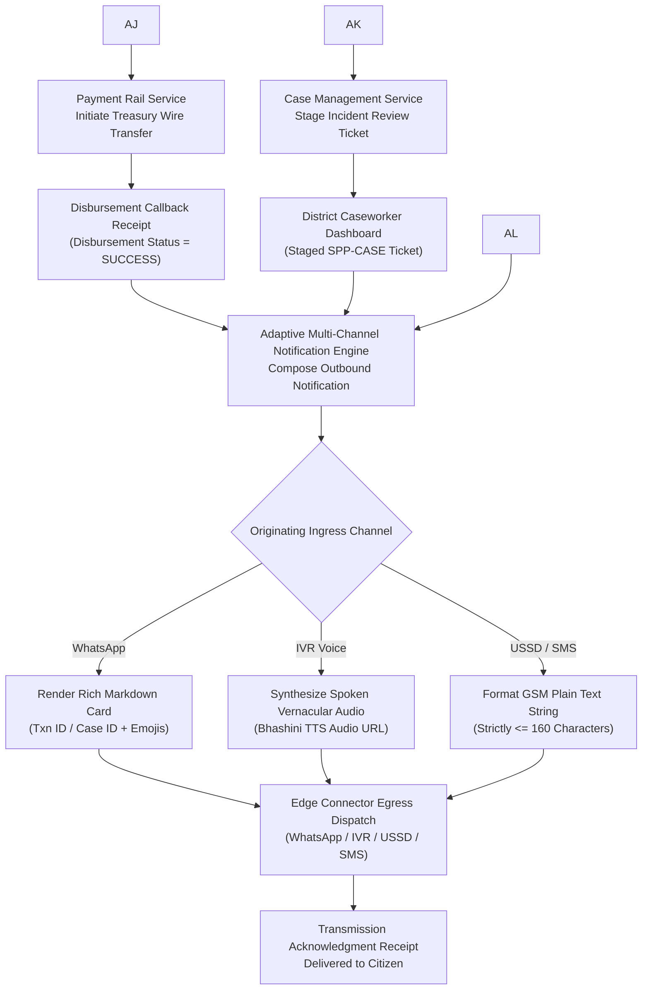
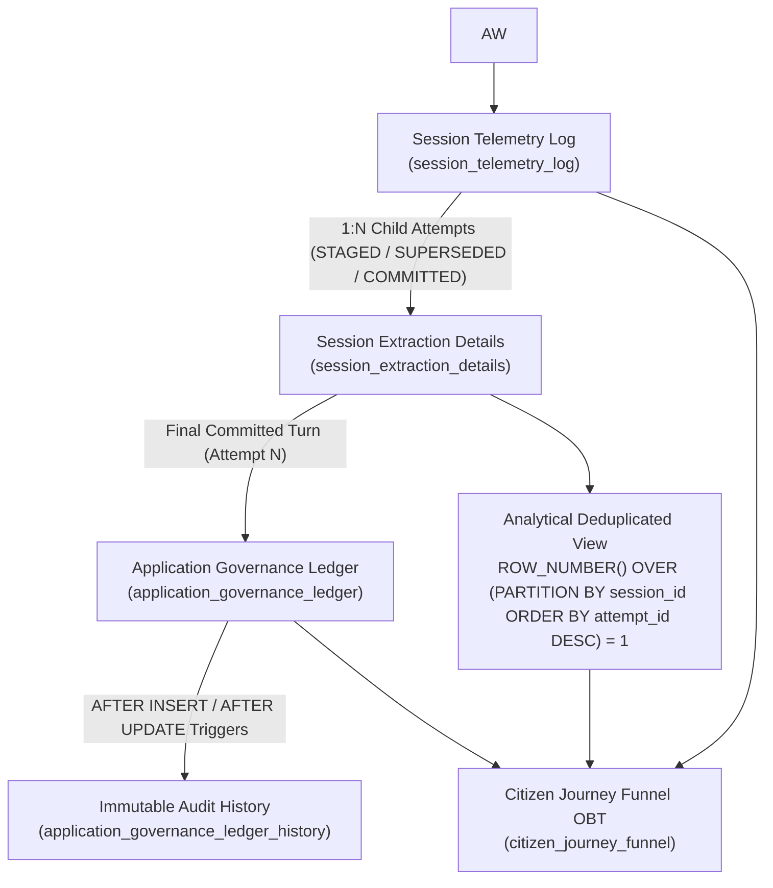

# End-to-End Architecture & Workflow: Ingress to Governance Determination

This document maps the complete end-to-end architectural workflow of **AgriStack DBT Core** — from an initial multi-channel citizen event (e.g., WhatsApp message, IVR voice call, USSD keypress) through the 4-layer Zero-Trust pipeline to the final governance determination and adaptive outbound delivery.

---

## 1. Master End-to-End Sequence Diagram

---

## 2. Detailed Execution Flow by Layer

### Phase 1: Edge Ingress & Layer 2 Perimeter Security

An inbound request arrives from a carrier network and is processed through perimeter security:

---

### Phase 2: Layer 3 Modality Handling & SLM Entity Extraction

The standardized intake contract enters Layer 3 for speech transcription and SLM domain entity extraction:

---

### Phase 3: Layer 4 Gate 2 — Intent & Completeness Validation

Gate 2 evaluates domain intent, checks for required fields, and coordinates multi-turn conversational re-prompts:

---

### Phase 4: Layer 4 Gate 3 — Governance Adjudication Matrix

Gate 3 cross-matches the claim against sovereign DPI registries and evaluates the tri-state decision matrix:

---

### Phase 5: Post-Decision Execution & Outbound Confirmation Delivery

Once the decision is made, financial clearing or caseworker queues are updated, and the outbound delivery service dispatches channel-native confirmations:

---

### Phase 6: Relational Persistence, Immutable Audit History & Analytical Deduplication

Operational state transitions and multi-turn conversational attempts are persisted to the normalized relational ledger while preserving strict Zero-PII invariants and preventing analytical cartesian fan-out:

1. **Multi-Turn Conversational State Separation**: Operational extraction attempts are recorded in `session_extraction_details` with lifecycle markers (`STAGED`, `SUPERSEDED`, `COMMITTED`).
2. **Window-Function Deduplication**: Downstream Business Intelligence (BI) views isolate the single authoritative extraction attempt per session via `ROW_NUMBER() OVER (PARTITION BY session_id ORDER BY attempt_id DESC) = 1`, eliminating multi-turn cartesian fan-out.
3. **Immutable Governance Audit Trail**: Database triggers (`AFTER INSERT`, `AFTER UPDATE`) automatically append every status and action transition to `application_governance_ledger_history` with actor attribution.

---

## 3. Data Contract Lifecycle & Transformation Progression

| Pipeline Stage | Active Data Contract | Key Attributes & Invariants | Consuming Architectural Layer |
| :--- | :--- | :--- | :--- |
| **Layer 1 Ingress** | *Carrier Ingress Contracts (WhatsApp, IVR, USSD, SMS)* | Raw phone number (`E.164`), raw text body or signed audio URL, held transiently for Layer 2 processing only. | Layer 2 Perimeter Security Gateway |
| **Layer 2 Security** | *Standardized Intake Payload* | 64-character SHA-256 HMAC pseudonymous citizen token. Zero cleartext PII. Redacted text content. | Layer 3 Public Agent Gateway |
| **Layer 3 Intake, Modality Processing & Extraction** | *Extracted Domain Entity Contract* | Application intent, domain entities map, AI confidence score, security threat flag. | Layer 4 Claim Governance Engine |
| **Layer 4 Adjudication** | *Claim Evaluation Contract $\rightarrow$ Governance Determination Outcome* | Governance action (`AUTO_APPROVE` / `ROUTE_FOR_MANUAL_REVIEW` / `AUTO_REJECT`), transaction ID, escalation case ID. | Sovereign Payment Rails / Caseworker Management Service |
| **Delivery Egress** | *Outbound Notification Request $\rightarrow$ Channel Notification Payload $\rightarrow$ Transmission Acknowledgment* | Adapted message string ($\le 160$ chars for USSD/SMS, Markdown card for WhatsApp, TTS URL for IVR), carrier message reference ID. | Originating Carrier Gateway $\rightarrow$ Citizen Device |
| **Persistence & Analytics** | *Relational Ledger Records $\rightarrow$ Citizen Journey Funnel View* | 64-character pseudonymous HMAC token, terminal JSONB governance metadata (`approval_amount` / `rejection_reason`), window-deduplicated attempt (`rn = 1`), immutable audit history. | Relational Database / Analytical BI Layer |
