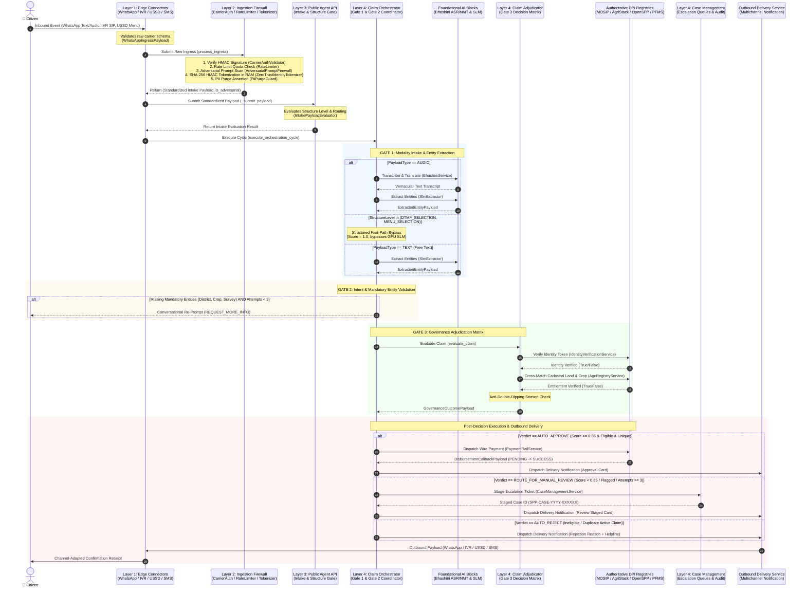
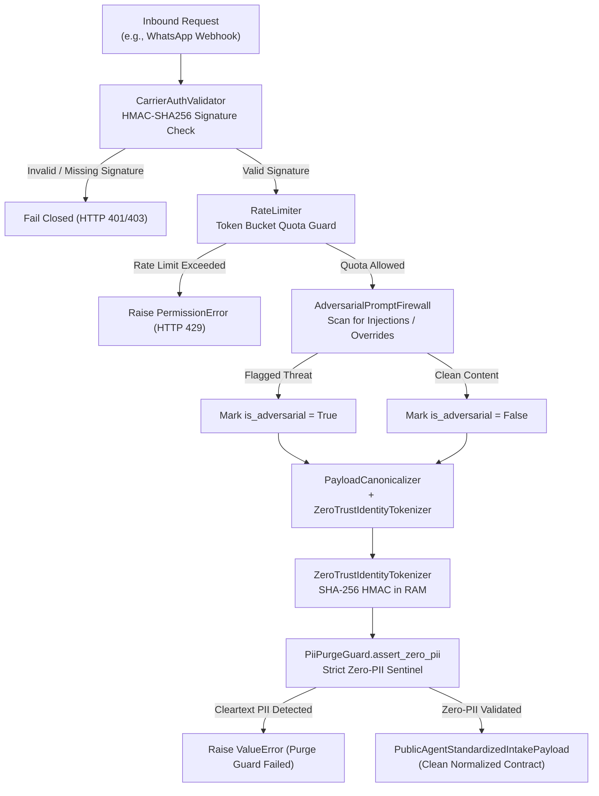
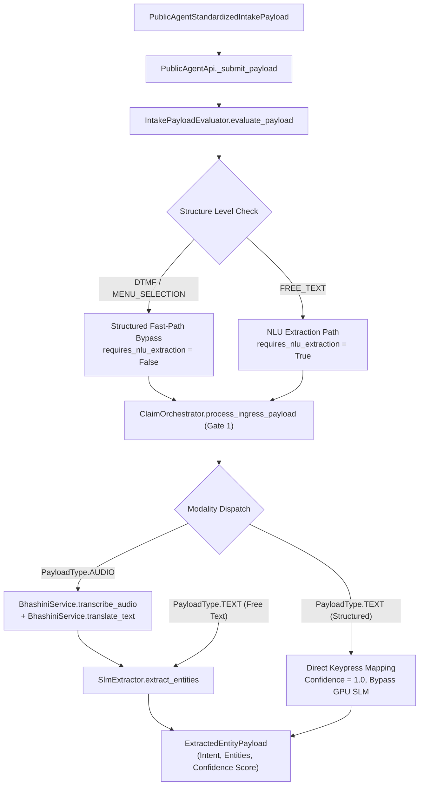
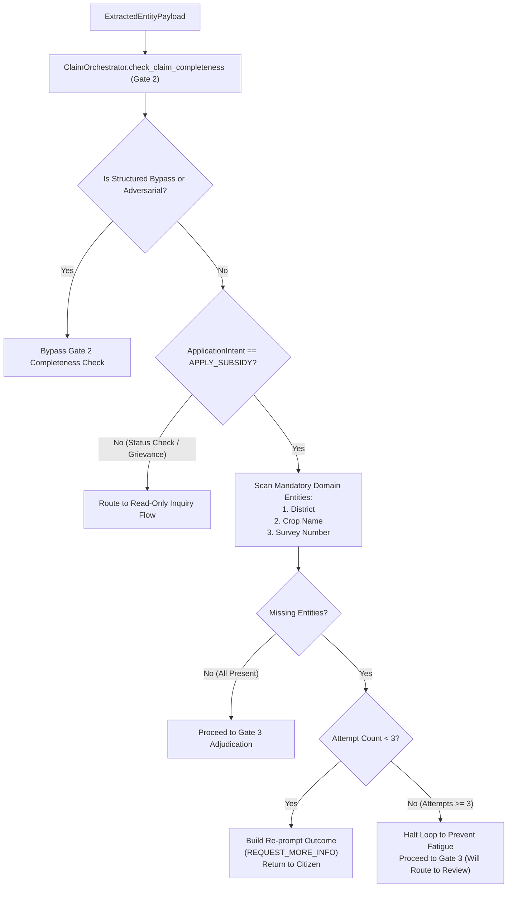
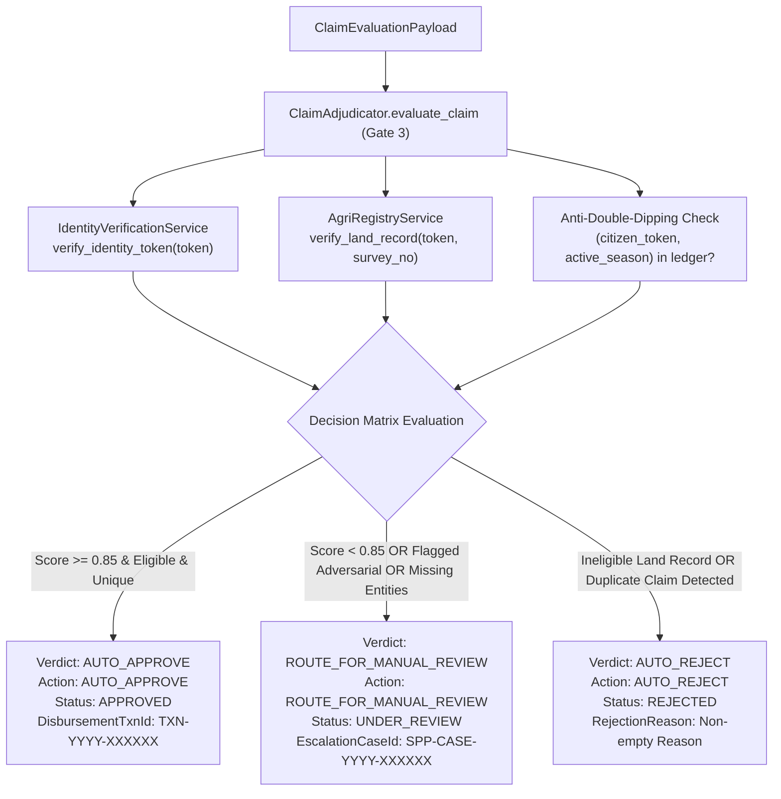
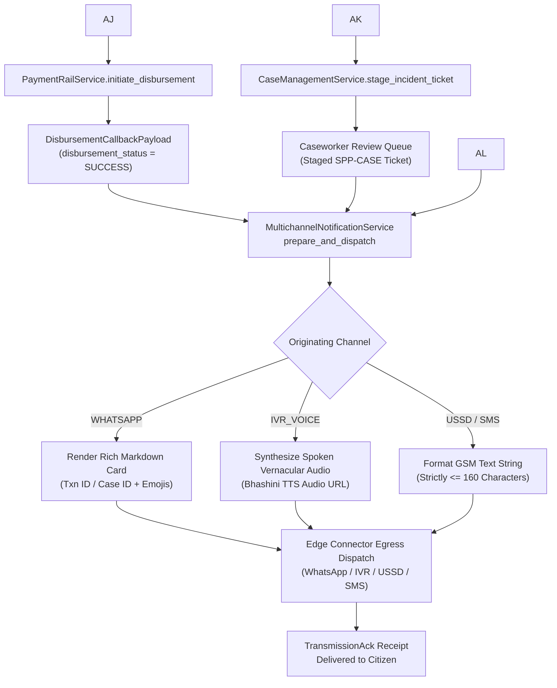

# End-to-End Architecture & Code Flow: Ingress to Governance Determination

This document maps the complete end-to-end code execution flow of **AgriStack DBT Core** — from an initial multi-channel citizen event (e.g., WhatsApp message, IVR voice call, USSD keypress) through the 4-layer Zero-Trust pipeline to the final governance determination and adaptive outbound delivery.

---

## 1. Master End-to-End Sequence Diagram

---

## 2. Detailed Execution Flow by Layer

### Phase 1: Edge Ingress & Layer 2 Perimeter Security

An inbound request arrives from a carrier network and is processed through perimeter security:

---

### Phase 2: Layer 3 Intake Evaluation & Layer 4 Gate 1

The standardized intake contract enters Layer 3 for structure classification, and Layer 4 Gate 1 executes modality handling:

---

### Phase 3: Layer 4 Gate 2 — Intent & Completeness Validation

Gate 2 evaluates domain intent, checks for required fields, and coordinates multi-turn conversational re-prompts:

---

### Phase 4: Layer 4 Gate 3 — Governance Adjudication Matrix

Gate 3 cross-matches the claim against sovereign DPI registries and evaluates the tri-state decision matrix:

---

### Phase 5: Post-Decision Execution & Outbound Confirmation Delivery

Once the decision is made, financial clearing or caseworker queues are updated, and the outbound delivery service dispatches channel-native confirmations:

---

## 3. Data Contract Lifecycle & Transformation Progression

| Pipeline Stage | Active Data Contract | Key Attributes & Invariants | Consuming Component |
| :--- | :--- | :--- | :--- |
| **Layer 1 Ingress** | [`WhatsAppIngressPayload`](../src/data_models/raw_ingress/whatsapp_payload.py) / [`IvrIngressPayload`](../src/data_models/raw_ingress/ivr_payload.py) / [`UssdIngressPayload`](../src/data_models/raw_ingress/ussd_payload.py) / [`SmsIngressPayload`](../src/data_models/raw_ingress/sms_payload.py) | Raw phone number (`E.164`), raw text body or audio URL. | [`IngestionFirewall`](../src/gateway/ingestion_firewall.py) |
| **Layer 2 Security** | [`PublicAgentStandardizedIntakePayload`](../src/data_models/public_agent/standardized_intake_payload.py) | 64-character SHA-256 HMAC `tokenized_citizen_id`. Zero cleartext PII. Redacted text content. | [`PublicAgentApi`](../src/public_agent/public_agent_api.py) |
| **Layer 3 Intake** | [`IntakeEvaluationResult`](../src/public_agent/intake_payload_evaluator.py) | `is_valid: bool`, `requires_nlu_extraction: bool` (fast-path bypass flag). | [`ClaimOrchestrator`](../src/orchestrator/claim_orchestrator.py) |
| **Gate 1 Extractor** | [`ExtractedEntityPayload`](../src/data_models/governance/extracted_entity_payload.py) | `application_intent`, `domain_entities: dict`, `ai_confidence_score: float`, `is_adversarial_attempt: bool`. | [`ClaimOrchestrator`](../src/orchestrator/claim_orchestrator.py) |
| **Gate 3 Adjudication** | [`ClaimEvaluationPayload`](../src/data_models/governance/claim_evaluation_payload.py) $\rightarrow$ [`GovernanceOutcomePayload`](../src/data_models/governance/governance_outcome_payload.py) | `governance_action` (`AUTO_APPROVE` / `ROUTE_FOR_MANUAL_REVIEW` / `AUTO_REJECT`), `disbursement_txn_id`, `escalation_case_id`. | [`PaymentRailService`](../src/services/dpi/payment_rail_service.py) / [`CaseManagementService`](../src/orchestrator/case_management_service.py) |
| **Delivery Egress** | [`NotificationRequestPayload`](../src/data_models/delivery/notification_request_payload.py) $\rightarrow$ [`OutboundNotificationPayload`](../src/data_models/delivery/outbound_notification_payload.py) $\rightarrow$ [`TransmissionAck`](../src/data_models/delivery/transmission_ack.py) | Adapted message string ($\le 160$ chars for USSD/SMS, Markdown for WhatsApp, TTS URL for IVR), carrier message reference. | Originating Carrier Gateway $\rightarrow$ Citizen |
