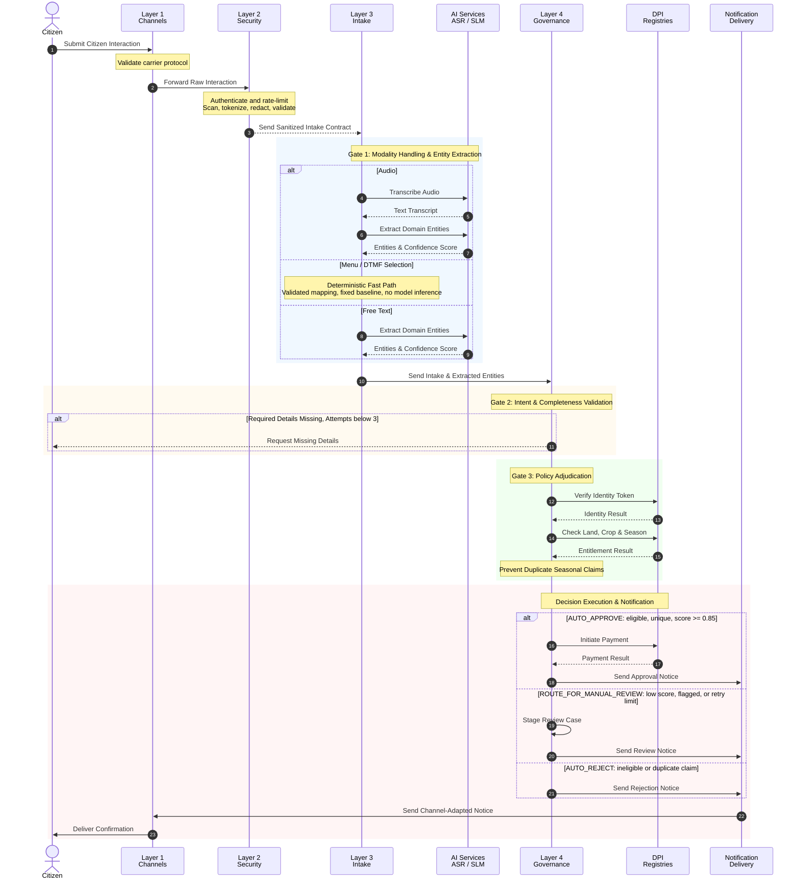
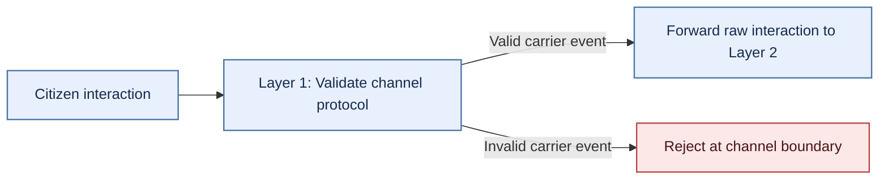
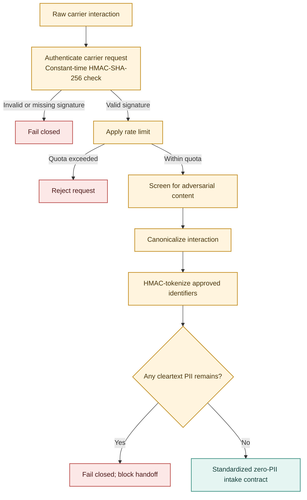
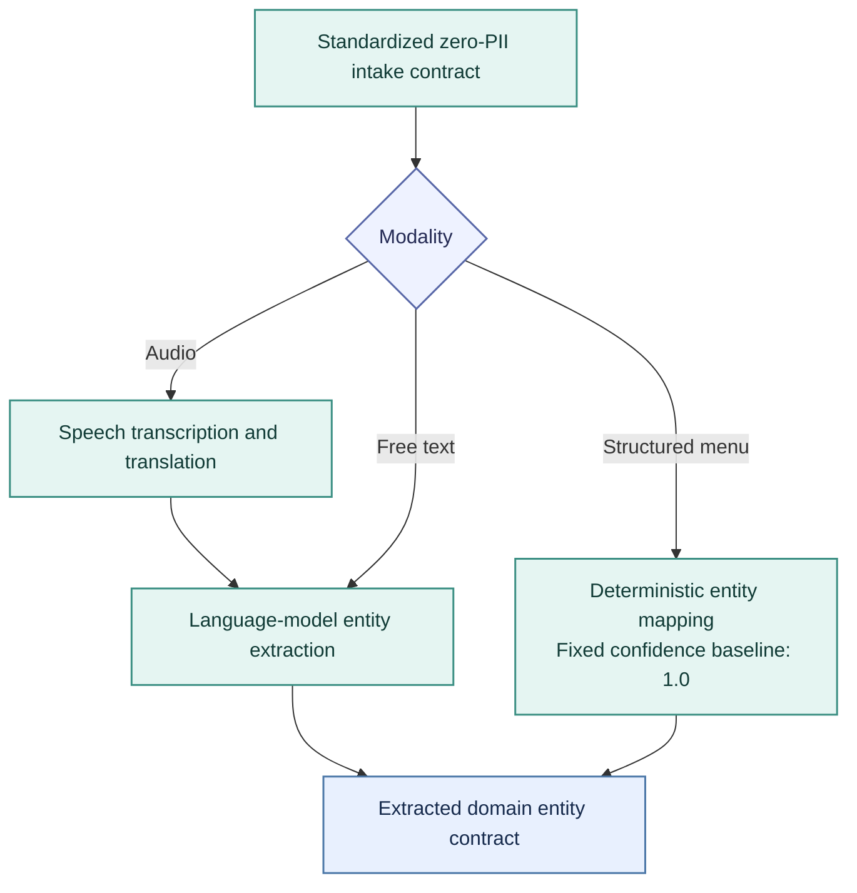
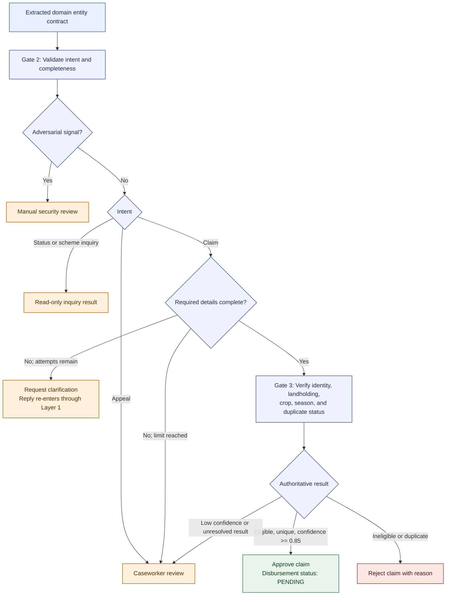
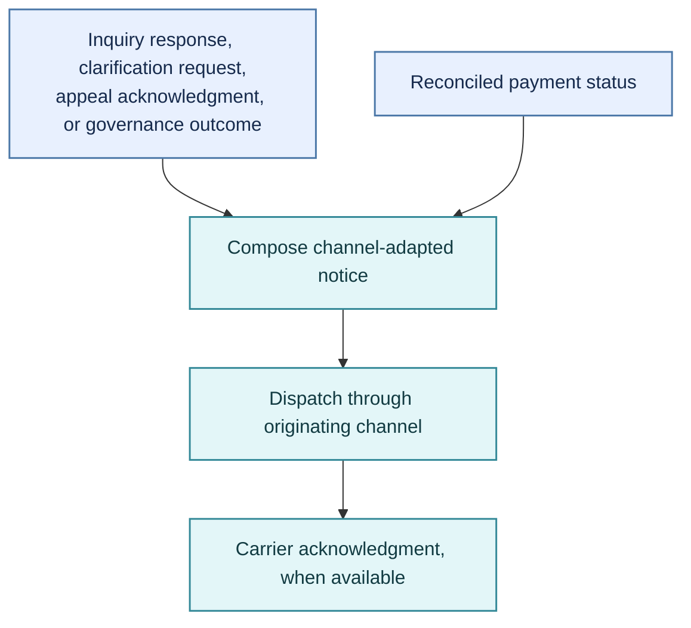
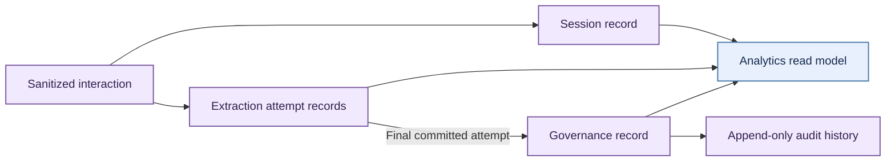

# End-to-End Architecture & Workflow: Citizen Ingress to Outcome Delivery

This document traces a citizen interaction through the **AgriStack DBT Core** Zero-Trust architecture: channel ingress, secure intake, governance evaluation, outcome handling, and citizen notification. It distinguishes the synchronous interaction from asynchronous payment settlement and treats persistence as cross-cutting rather than a final runtime step.

The detailed flow follows meaningful runtime boundaries rather than forcing a fixed number of stages: channel ingress and perimeter security, Layer 3 intake, Layer 4 validation and adjudication, and outcome handling. Persistence and analytics are shown separately because they span or follow those runtime boundaries.

---

## 1. Master End-to-End Sequence Diagram

The master view shows the major system handoffs. Modality and governance branches are detailed under their lifecycle boundaries below. Payment settlement is asynchronous and separate from the citizen request path.

---

## 2. Detailed Flow by Lifecycle Boundary

Color key: **blue** ingress · **amber** security · **teal** intake and delivery · **indigo** governance · **green** approval · **orange** review · **red** rejection · **purple** persistence.

### Layer 1 Ingress: Carrier Interaction

The originating channel validates its transport protocol and forwards the interaction. Raw identifiers and content remain transient and are passed only to Layer 2 for sanitization.

### Layer 2 Security: Standardized Zero-PII Intake Contract

Layer 2 authenticates and rate-limits the carrier request, screens content, tokenizes approved identifiers, canonicalizes the interaction, and fails closed if cleartext PII remains.

### Layer 3 Intake & Extraction: Extracted Domain Entity Contract

Layer 3 converts each supported modality into the same intent-and-entity contract. Structured menu selections bypass model inference but still proceed through Layer 4 intent and completeness validation.

### Layer 4 Governance: Claim Evaluation & Governance Outcome

Gate 2 handles intent and intake completeness. Status and scheme inquiries follow a read-only route, while appeals go to caseworker review. District and crop are required at intake; a survey number may be resolved during registry matching. A citizen clarification reply is a new ingress interaction, not a bypass around the perimeter controls. Gate 3 verifies identity and entitlement against sovereign registries.

**Outcome rules:** Claims with confidence of at least `0.85` and verified as eligible and unique are approved. Adversarial signals route to manual security review. Confidence below `0.85`, unresolved verification, or exhausted clarification attempts route to manual case review. Only authoritative ineligibility or a duplicate active claim results in rejection; an unavailable or inconclusive registry result is not proof of ineligibility. Payment dispatch follows approval asynchronously and does not change the governance outcome.

### Notification Egress: Channel-Adapted Citizen Notice

Notification delivery consumes inquiry responses, appeal acknowledgments, clarification requests, and governance outcomes. Payment settlement can later produce a separate status notice. The notification is rendered for the originating channel; the carrier acknowledgment is recorded when available.

---

## 3. Persistence & Analytics: Operational Records & Analytical Read Models

Session, extraction, governance, and financial records are persisted as the interaction progresses; persistence is not a post-delivery stage. Only tokenized identifiers and redacted content cross the durable-storage boundary. Governance and financial state changes are captured in an append-only audit history. Analytical views are downstream read models, not part of the citizen request path.

Multi-turn attempts remain distinguishable so analytics can select the committed extraction for a governance outcome without counting every clarification turn as a separate claim. The audit history records governance-state changes with actor attribution.

---

## 4. Data Contract Lifecycle & Transformation Progression

| Lifecycle Boundary | Active Data Contract | Key Attributes & Invariants | Consuming Architectural Layer |
| :--- | :--- | :--- | :--- |
| **Layer 1 Ingress** | *Carrier Interaction* | Raw identifiers and content are transient and passed only to perimeter security for sanitization. | Layer 2 Perimeter Security |
| **Layer 2 Security** | *Standardized Zero-PII Intake Contract* | Approved identifiers are HMAC-tokenized; cleartext PII is removed before the Layer 3 handoff. | Layer 3 Intake |
| **Layer 3 Intake & Extraction** | *Extracted Domain Entity Contract* | Intent, extracted entities, confidence, and security signal; structured menu input is mapped without model inference. | Layer 4 Governance |
| **Layer 4 Governance** | *Claim Evaluation & Governance Outcome* | Approval, manual review, or rejection with the applicable transaction, case, or reason details. | Payment Rails, Caseworker Queue, and Notification Delivery |
| **Notification Egress** | *Channel-Adapted Citizen Notice* | Content is rendered for the originating channel; a carrier receipt records transport feedback. | Originating Channel |
| **Persistence & Analytics** | *Operational Records & Analytical Read Models* | Tokenized and redacted records, auditable state changes, and deduplicated views for reporting. | Relational Store and Analytics |
