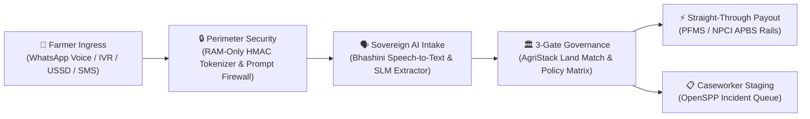
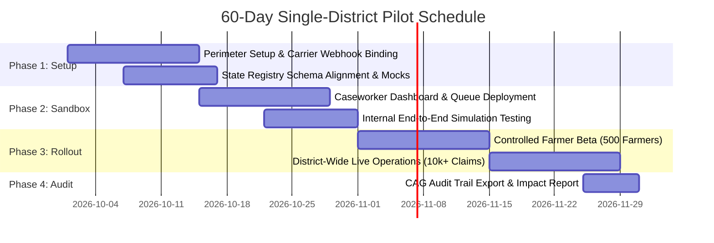

# Sovereign Digital Public Infrastructure Pilot Proposal
## Next-Generation Direct Benefit Transfer (DBT) Orchestrator for Agriculture

**Prepared for:** State Departments of Agriculture & State Information Technology Development Agencies  
**Supported Standards:** AgriStack, Digital India Bhashini, MOSIP, OpenSPP, and NPCI/PFMS Rails  
**Regulatory Alignment:** Digital Personal Data Protection (DPDP) Act 2023 & Aadhaar Act §29  

---

## 1. Executive Summary

State Direct Benefit Transfer (DBT) schemes for agriculture—including crop loss compensation, input subsidies, and disaster relief—face four fundamental administrative bottlenecks:

1. **The Last-Mile Vernacular Exclusion Barrier**: Over 70% of smallholder farmers struggle with complex 14-page multi-step web portals, forcing them to rely on Common Service Centre (CSC) intermediaries who charge informal facilitation fees of ₹200 to ₹500 per application.
2. **Data Privacy & Statutory Liability (DPDP Act 2023)**: Persistent storage of cleartext Aadhaar numbers and mobile phone numbers across distributed government databases exposes departmental leadership to severe regulatory penalties and citizen privacy risks.
3. **Cloud & AI Inference Cost Overruns**: Deploying massive language models across millions of citizen interactions rapidly exhausts state IT budgets on GPU hosting.
4. **Audit Liability & Double-Dipping Fraud**: Disbursing public funds without immutable, tamper-evident audit logs risks adverse Comptroller and Auditor General (CAG) findings, while lack of cross-season deduplication enables fraudulent double-claiming.

**AgriStack DBT Core** is a sovereign-aligned, Zero-Trust Direct Benefit Transfer simulation and orchestration platform. It enables farmers to apply for agricultural entitlements in their native spoken dialect via WhatsApp Voice Notes, IVR phone calls, USSD menu signaling (`*99#`), or SMS, and coordinates straight-through deterministic adjudication against land registries and treasury rails with strict Zero-PII guarantees.

---

## 2. Core Architectural Pillars

### 2.1 Omnichannel Accessibility: Voice, Text, and Feature Phones
Farmers interact through the tools they already use daily:
- **WhatsApp Messaging & Voice Notes**: Farmers record audio messages in vernacular Hindi or regional dialects explaining crop damage (*"Mera 2 acre gehu barish se kharab ho gaya"*).
- **Interactive Voice Response (IVR)**: Automated inbound dial-in supporting vernacular speech recognition and interactive voice synthesis.
- **USSD Signaling (`*99#`) & SMS Relay**: Feature-phone access requiring zero internet connectivity or smartphone ownership.

### 2.2 Sovereign Zero-Trust Security & DPDP Act 2023 Compliance
- **RAM-Only Cryptographic Tokenization**: Cleartext phone numbers and Aadhaar identifiers are ingested strictly into volatile RAM, transformed into cryptographically peppered 64-character SHA-256 HMAC pseudonymous tokens, and instantly purged from memory.
- **Strict Zero-Retention Disk Storage**: Persistent operational tables and analytical warehouses store exclusively HMAC tokens. Cleartext citizen identifiers never touch persistent disk storage.
- **Adversarial Threat Firewall**: Inbound citizen text is inspected at the perimeter for system overrides, role usurpation, and delimiter injection. Suspected adversarial payloads are neutralized before reaching language models.

### 2.3 Hybrid Cost Optimization: Structured Fast-Path
To prevent unsustainable GPU compute costs:
- **Menu & USSD Fast-Path Bypass**: Structured inputs (numeric DTMF keypad presses and USSD menu selections) are routed deterministically, bypassing GPU language model inference entirely with 100% confidence.
- **Targeted Vernacular Perception**: Language models are reserved exclusively for unstructured voice notes and vernacular text queries.

### 2.4 Deterministic Three-Gate Governance & Anti-Double-Dipping
Government funds are never allocated by non-deterministic artificial intelligence:
- **Gate 1 (Ingress & Modality)**: Standardizes multi-channel carrier events into canonical intake contracts.
- **Gate 2 (Completeness & Conversational Loops)**: Checks for mandatory domain parameters (District, Crop Name, Survey/Khasra Number) and initiates up to 3 automated conversational re-prompts before escalating.
- **Gate 3 (Deterministic Policy Matrix)**: Evaluates extracted parameters against AgriStack cadastral land records and seasonal double-dipping ledgers:
  - **Automated Payout (`AUTO_APPROVE`)**: Extraction confidence $\ge 85\%$, land ownership confirmed in registry, no prior claim in active season.
  - **Caseworker Review (`ROUTE_FOR_MANUAL_REVIEW`)**: Extraction confidence $< 85\%$, boundary discrepancies, or flagged overrides staged into district caseworker queues.
  - **Automated Rejection (`AUTO_REJECT`)**: Ineligible land record, mismatched crop season, or duplicate claim.

---

## 3. The 60-Day Single-District Pilot Blueprint

We propose a **60-Day Single-District Pilot** covering one selected agricultural district (e.g., Karnal in Haryana, Nashik in Maharashtra, or Gorakhpur in Uttar Pradesh) focused on **Crop Damage Compensation** or **Seasonal Input Subsidies**.

### Phase 1: Environment Readiness & Channel Binding (Days 1–14)
- Deploy the orchestrator in the State Data Centre (SDC), MeghRaj NIC Cloud, or dedicated cloud tenancy.
- Provision WhatsApp Business API number, state IVR SIP trunk, and dedicated shortcode/USSD endpoint.
- Connect the perimeter security gateway to state secret managers for tokenization key management.

### Phase 2: Registry Integration & Sandbox Verification (Days 15–28)
- Cross-connect with state land records (AgriStack / Bhulekh / e-Bhoomi) and farmer registry databases.
- Deploy the web-based district caseworker incident review queue for manual escalation routing.
- Execute automated end-to-end verification suites verifying 100% compliance across all test cases.

### Phase 3: Controlled Field Rollout (Days 29–50)
- **Cohort A (Days 29–42)**: Controlled trial with 500 progressive farmers across 5 pilot blocks.
- **Cohort B (Days 43–50)**: Open district-wide availability across all agricultural blocks.
- Monitor automated straight-through processing rates, conversational reprompt completion, and caseworker resolution turnaround times.

### Phase 4: Comprehensive Audit & Transition (Days 51–60)
- Generate automated analytical reporting using window-function deduplication (`ROW_NUMBER() OVER`) to prove zero cartesian fan-out.
- Export immutable SQL audit history trails demonstrating end-to-end accountability for CAG review.
- Deliver comprehensive technical documentation, architecture decision records, and operational runbooks.

---

## 4. Key Performance Indicators (KPIs)

| Performance Dimension | Traditional Web / Physical Workflow | Target with AgriStack DBT Core |
| :--- | :--- | :--- |
| **Claim Submission Time** | 3 to 7 days (CSC physical visit) | $< 3$ minutes via WhatsApp Voice or IVR |
| **Intermediary Leakage** | ₹200–₹500 per application | ₹0 (Direct self-service from citizen phone) |
| **Straight-Through Processing** | $0\%$ (100% manual file processing) | $\ge 65\%$ automated payout within 24 hours |
| **Caseworker Processing Burden** | 100% of all submitted claims | $< 35\%$ (Only high-risk / ambiguous claims) |
| **PII Data Breach Risk** | High (Cleartext Aadhaar/phones in CSVs) | Zero (RAM-only cryptographic tokenization) |
| **Audit Resolution Time** | Weeks (Tracing paper files) | Instantaneous via automated SQL audit ledger |

---

## 5. Technical Specifications for RFP & Tender Inclusion

State IT agencies and Project Management Units (PMUs) can incorporate the following technical clauses directly into upcoming tender documents and procurement specifications:

1. **Zero-Trust Identity Protection**:
   *The system must tokenize all primary citizen identifiers (including mobile telephone numbers and national identification numbers) within volatile random access memory (RAM) prior to persistent ledger storage or service transmission, utilizing an automated SHA-256 HMAC algorithm with hardware-secured secret peppers. Cleartext personal data must be strictly barred from touching persistent storage volumes or log files.*
2. **Omnichannel Ingress Convergence**:
   *The platform must provide a unified public agent intake gateway capable of normalizing inbound interactions across WhatsApp Business API, Interactive Voice Response (IVR), USSD protocol, and Short Message Service (SMS) into a standardized intake contract.*
3. **Sovereign Speech & Dialect Transcription**:
   *The solution must integrate with national sovereign artificial intelligence pipelines (Digital India Bhashini) for automated speech recognition (ASR), neural machine translation (NMT), and text-to-speech (TTS) across scheduled regional languages.*
4. **Deterministic Multi-Gate Governance**:
   *The orchestration engine must enforce strict separation between probabilistic AI entity extraction and deterministic financial adjudication. All entitlement approvals, benefit calculations, and payment dispatches must be governed by deterministic rules cross-matched against authoritative land registries.*
5. **Immutable Audit History**:
   *All lifecycle state transitions for benefit applications must be recorded in an immutable historical ledger table governed by database-level triggers, recording timestamped state deltas and reviewing actor identifiers for statutory audit readiness.*

---

## 6. Next Steps & Commercial Engagement

To initiate a single-district pilot:
1. **Letter of Intent (LoI)**: Department of Agriculture issues a formal pilot letter authorizing single-district sandbox evaluation.
2. **Startup India / GeM Procurement**: Direct work order under General Financial Rules (GFR) Rule 170/173 exemptions for DPIIT-recognized innovative startups, or through state IT agency rate contracts.
3. **Kickoff Workshop**: 2-day stakeholder alignment with district agricultural officers and state IT leadership.
