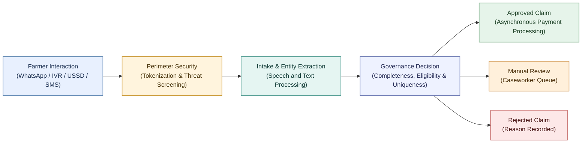
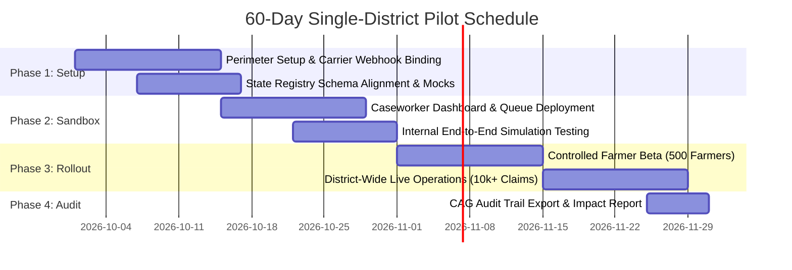

# Sovereign Digital Public Infrastructure Pilot Proposal
## Next-Generation Direct Benefit Transfer (DBT) Orchestrator for Agriculture

**Prepared for:** State Departments of Agriculture & State Information Technology Development Agencies  
**Supported Standards:** AgriStack, Digital India Bhashini, MOSIP, OpenSPP, and NPCI/PFMS Rails  
**Regulatory Alignment:** Digital Personal Data Protection (DPDP) Act 2023 & Aadhaar Act §29  

---

## 1. Executive Summary

State Direct Benefit Transfer (DBT) schemes for agriculture—including crop loss compensation, input subsidies, and disaster relief—face four fundamental administrative bottlenecks:

1. **The Last-Mile Vernacular Exclusion Barrier**: Multi-step web forms and dependence on Common Service Centre (CSC) intermediaries can create access barriers. The pilot should establish a district-specific baseline for application effort, completion, and any facilitation costs rather than assume a single national rate.
2. **Data Privacy & Statutory Liability (DPDP Act 2023)**: Persistent storage of cleartext Aadhaar numbers and mobile phone numbers across distributed government databases exposes departmental leadership to severe regulatory penalties and citizen privacy risks.
3. **Cloud & AI Inference Cost Overruns**: Deploying massive language models across millions of citizen interactions rapidly exhausts state IT budgets on GPU hosting.
4. **Audit Liability & Double-Dipping Fraud**: Disbursing public funds without immutable, tamper-evident audit logs risks adverse Comptroller and Auditor General (CAG) findings, while lack of cross-season deduplication enables fraudulent double-claiming.

**AgriStack DBT Core** is a sovereign-aligned, Zero-Trust Direct Benefit Transfer simulation and orchestration platform. It enables farmers to apply for agricultural entitlements in their native spoken dialect via WhatsApp Voice Notes, IVR phone calls, USSD menu signaling (`*147#`), or SMS, and coordinates deterministic adjudication against land registries and treasury rails. Direct identifiers are tokenized at the Layer 2 perimeter, and free-text content must be redacted before downstream processing.

---

## 2. Core Architectural Pillars

### 2.1 Omnichannel Accessibility: Voice, Text, and Feature Phones
Farmers interact through the tools they already use daily:
- **WhatsApp Messaging & Voice Notes**: Farmers record audio messages in vernacular Hindi or regional dialects explaining crop damage (*"Mera 2 acre gehu barish se kharab ho gaya"*).
- **Interactive Voice Response (IVR)**: Automated inbound dial-in supporting vernacular speech recognition and interactive voice synthesis.
- **USSD Signaling (`*147#`) & SMS Relay**: Feature-phone access requiring zero internet connectivity or smartphone ownership.

### 2.2 Sovereign Zero-Trust Security & DPDP Act 2023 Compliance
- **RAM-Only Cryptographic Tokenization**: Phone numbers and other approved identifiers are processed in volatile memory, transformed into keyed 64-character HMAC-SHA-256 pseudonymous tokens, and removed from the downstream contract. Raw Aadhaar must not be directly hashed; use an authorized UIDAI-issued pseudonymous identifier where required.
- **Strict Zero-Retention Disk Storage**: Identity columns store tokens rather than cleartext identifiers. Other persisted fields must be minimized, and free-text content must be PII-redacted before persistence; tokens remain sensitive and linkable.
- **Adversarial Threat Firewall**: Inbound citizen text is inspected at the perimeter for system overrides, role usurpation, and delimiter injection. Suspected adversarial payloads are neutralized before reaching language models.

### 2.3 Hybrid Cost Optimization: Structured Fast-Path
To prevent unsustainable GPU compute costs:
- **Menu & USSD Fast-Path Bypass**: Structured inputs (numeric DTMF keypad presses and USSD menu selections) are routed deterministically, bypassing GPU language model inference entirely with 100% confidence.
- **Targeted Vernacular Perception**: Language models are reserved exclusively for unstructured voice notes and vernacular text queries.

### 2.4 Deterministic Three-Gate Governance & Anti-Double-Dipping
Government funds are never allocated by non-deterministic artificial intelligence:
- **Gate 1 (Ingress & Modality)**: Standardizes multi-channel carrier events into canonical intake contracts.
- **Gate 2 (Completeness & Conversational Loops)**: Checks for mandatory domain parameters (District and Crop Name) and initiates bounded clarification before escalating. Survey/Khasra Number is optional at intake and may be resolved during Gate 3 registry matching.
- **Gate 3 (Deterministic Policy Matrix)**: Evaluates extracted parameters against AgriStack cadastral land records and seasonal double-dipping ledgers:
  - **Automated Payout (`AUTO_APPROVE`)**: Extraction confidence $\ge 85\%$, land ownership confirmed in registry, no prior claim in active season.
  - **Caseworker Review (`ROUTE_FOR_MANUAL_REVIEW`)**: Extraction confidence $< 85\%$, boundary discrepancies, or flagged overrides staged into district caseworker queues.
  - **Automated Rejection (`AUTO_REJECT`)**: Ineligible land record, mismatched crop season, or duplicate claim.

---

## 3. The 60-Day Single-District Pilot Blueprint

We propose a **60-Day Single-District Pilot** covering one selected agricultural district (e.g., Karnal in Haryana, Nashik in Maharashtra, or Gorakhpur in Uttar Pradesh) focused on **Crop Damage Compensation** or **Seasonal Input Subsidies**.

### Phase 1: Environment Readiness & Channel Binding (Days 1–14)
- Deploy the orchestrator in the State Data Centre (SDC), MeghRaj NIC Cloud, or dedicated cloud tenancy.
- Provision WhatsApp Business API number, state IVR SIP trunk, and dedicated shortcode/USSD endpoint.
- Connect the perimeter security gateway to state secret managers for tokenization key management.
- Establish empirical pre-pilot district baseline: Sample existing portal and assisted workflows to establish local completion rates, application turnaround time, drop-off rates, and facilitation costs.

### Phase 2: Registry Integration & Sandbox Verification (Days 15–28)
- Cross-connect with state land records (AgriStack / Bhulekh / e-Bhoomi) and farmer registry databases.
- Deploy the web-based district caseworker incident review queue for manual escalation routing.
- Execute automated end-to-end verification suites verifying 100% compliance across all test cases.

### Phase 3: Controlled Field Rollout (Days 29–50)
- **Cohort A (Days 29–42)**: Controlled trial with 500 progressive farmers across 5 pilot blocks.
- **Cohort B (Days 43–50)**: Open district-wide availability across all agricultural blocks.
- Monitor automated straight-through processing rates, conversational reprompt completion, and caseworker resolution turnaround times.

### Phase 4: Comprehensive Audit & Transition (Days 51–60)
- Generate automated analytical reporting using window-function deduplication (`ROW_NUMBER() OVER`) to prove zero cartesian fan-out.
- Export immutable SQL audit history trails demonstrating end-to-end accountability for CAG review.
- Deliver comprehensive technical documentation, architecture decision records, and operational runbooks.

---

## 4. Key Performance Indicators (KPIs)

To evaluate the pilot's operational, fiscal, and accessibility impacts, the Project Management Unit (PMU) tracks the following core performance dimensions:

| Measure | How to measure | Baseline and target |
| :--- | :--- | :--- |
| Submission completion and time | Sample comparable applications by channel; measure from first interaction to valid submission, including abandoned sessions. | Establish from current district process; set target with scheme owners before launch. |
| Channel reach and accessibility | Track eligible users reached, successful channel starts, completion, language, and accessibility issues, using minimized data. | Baseline and targets agreed with district outreach and inclusion teams. |
| Straight-through decision rate | Share of eligible submitted claims receiving a deterministic decision without manual intervention; report approval and rejection separately. | Measure against sandbox and current process; set target only after scheme rules and data quality are assessed. |
| Manual review workload and turnaround | Track incoming cases, reviewer hours, queue age, resolution time, and outcomes. | Size cohort and service targets against appointed reviewer capacity. |
| Registry and service reliability | Track integration availability, response time, failure and retry rates, and unresolved verification results. | Set service thresholds with each system owner before live integration. |
| Privacy and security | Record security incidents, unauthorized disclosures, tokenization/purge failures, access exceptions, and retention findings. | Zero tolerance for unauthorized PII disclosure; define incident response and audit method before launch. |
| Audit completeness | Sample claims and verify traceability of decision inputs, state changes, reviewer actions, and payment callbacks. | Agree the sampling method and required evidence with authorized audit stakeholders. |

### 4.1 Rationale for District-Specific Baseline Calibration

Government DBT pilots often encounter audit and administrative challenges when performance is evaluated against hypothetical national averages rather than empirical local baselines. The pilot mandates establishing a pre-implementation district baseline based on three operational imperatives:

1. **Infrastructural & Socio-Economic Heterogeneity**:
   Intermediary density (such as Common Service Centres and village kiosks), village-to-kiosk transit distances, mobile network coverage (2G vs. 4G/5G), and vernacular dialect comprehension vary substantially across districts. A standardized national assumption obscures whether citizen friction stems from technical barriers, language mismatch, or physical transit constraints.

2. **Counterfactual & Evaluation Integrity**:
   Measuring genuine administrative efficiency (application completion rate, time-to-decision, and reduction in out-of-pocket citizen costs) requires an auditable local counterfactual. Comparing pilot outcomes against the actual pre-existing workflow of the chosen pilot district prevents artificial impact inflation, provides credible attribution, and withstands scrutiny by state finance departments and statutory auditors.

3. **Informed Channel & Capacity Sizing**:
   Empirical baseline assessment reveals local channel preferences (e.g., the proportion of feature-phone IVR/USSD users relative to smartphone WhatsApp users) and existing caseworker review latency. This allows the Project Management Unit (PMU) to right-size cloud resources, telephony trunks, and departmental review queues prior to district-wide live operations.

---

## 5. Technical Specifications for RFP & Tender Inclusion

State IT agencies and Project Management Units (PMUs) can incorporate the following technical clauses directly into upcoming tender documents and procurement specifications:

1. **Zero-Trust Identity Protection**:
   *The system must tokenize all primary citizen identifiers (including mobile telephone numbers and national identification numbers) within volatile random access memory (RAM) prior to persistent ledger storage or service transmission, utilizing an automated SHA-256 HMAC algorithm with hardware-secured secret peppers. Cleartext personal data must be strictly barred from touching persistent storage volumes or log files.*
2. **Omnichannel Ingress Convergence**:
   *The platform must provide a unified public agent intake gateway capable of normalizing inbound interactions across WhatsApp Business API, Interactive Voice Response (IVR), USSD protocol, and Short Message Service (SMS) into a standardized intake contract.*
3. **Sovereign Speech & Dialect Transcription**:
   *The solution must integrate with national sovereign artificial intelligence pipelines (Digital India Bhashini) for automated speech recognition (ASR), neural machine translation (NMT), and text-to-speech (TTS) across scheduled regional languages.*
4. **Deterministic Multi-Gate Governance**:
   *The orchestration engine must enforce strict separation between probabilistic AI entity extraction and deterministic financial adjudication. All entitlement approvals, benefit calculations, and payment dispatches must be governed by deterministic rules cross-matched against authoritative land registries.*
5. **Immutable Audit History**:
   *All lifecycle state transitions for benefit applications must be recorded in an immutable historical ledger table governed by database-level triggers, recording timestamped state deltas and reviewing actor identifiers for statutory audit readiness.*

---

## 6. Next Steps & Commercial Engagement

To initiate a single-district pilot:
1. **Letter of Intent (LoI)**: Department of Agriculture issues a formal pilot letter authorizing single-district sandbox evaluation.
2. **Procurement Route Alignment**: Departmental procurement and finance authorities select the appropriate onboarding mechanism under applicable state rules (e.g., State IT rate contracts, Government e-Marketplace [GeM], or innovation pilot provisions). Any startup exemptions under DPIIT (Department for Promotion of Industry and Internal Trade) or sandbox frameworks should be formally confirmed with the competent purchasing authority.
3. **Kickoff workshop**: Align district agriculture officers, state IT leadership, registry owners, security, and operations stakeholders. Set the workshop duration during planning.
